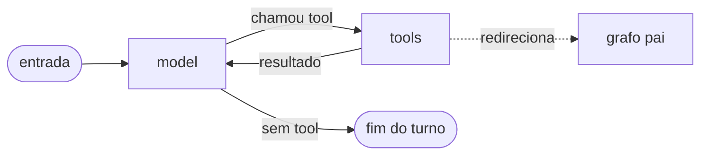

# Banco Ágil

## Sumário

1. [Visão geral](#visao-geral)
   - [Funcionalidades](#funcionalidades)
2. [Arquitetura](#arquitetura)
3. [Decisões técnicas](#decisoes)
   - [Como estruturar a arquitetura multi-agent e quais padrões utilizar?](#decisao-arquitetura)
   - [Como controlar a autonomia dos agentes sem perder o controle do fluxo?](#decisao-autonomia)
   - [O que deve ser decidido pelo LLM e o que deve permanecer determinístico?](#decisao-determinismo)
   - [Como garantir que valores e resultados apresentados ao cliente sejam confiáveis?](#decisao-valores)
   - [Como preservar o contexto durante os handoffs entre agentes?](#decisao-contexto)
   - [Como modelar fluxos que exigem múltiplas interações?](#decisao-fluxos)
   - [Como impedir que um agente utilize capacidades fora do seu escopo?](#decisao-escopo)
   - [Como separar a intenção de encerrar a conversa do encerramento efetivo da execução?](#decisao-encerramento)
   - [Como avaliar um sistema cujo comportamento é parcialmente não determinístico?](#decisao-avaliacao)
   - [Como garantir que o próprio Judge seja confiável?](#decisao-judge)
   - [Como tratar falhas externas e entradas inválidas sem quebrar a experiência?](#decisao-falhas)
4. [Execução](#execucao)
5. [Evaluation e testes](#evaluation)
   - [Homologação](#homologacao)
6. [Resultados](#resultados)
7. [Desafios](#desafios)
   - [A suíte e o judge mediam coisas diferentes](#desafio-suite)
   - [O crédito encerrou a conversa no handoff da entrevista](#desafio-entrevista)
8. [Limitações](#limitacoes)
9. [Próximos passos](#proximos-passos)
10. [Estrutura do projeto](#estrutura)
11. [Q&A](#qa)
    - [Por que uma tool por passo?](#qa-uma-tool)
    - [Por que o state compartilhado, em vez de states dedicados?](#qa-state)
    - [Por que alguns agents não escolhem as tools por bind_tools?](#qa-bind-tools)
12. [Apêndices](#apendices)
     - [Entrada completa](#apendice-entrada)
     - [Loop do subgraph](#apendice-loop)

<a id="visao-geral"></a>

## 1. Visão geral

Atendimento de um banco digital fictício. O cliente fala com um assistente no Streamlit. Por baixo, quatro agents em LangGraph dividem o trabalho: triagem, crédito, entrevista e câmbio. A troca entre eles é um handoff. O chat não mostra essa troca.

A triagem autentica CPF e data de nascimento em `clientes.csv`. Só depois o assunto segue para o agent que pode resolvê-lo. Limite, score, pedido e cotação vêm de tools. O modelo conduz a conversa e escolhe a tool. A regra fica no código.

A conversa fica na sessão do navegador. Clientes, faixas de limite e pedidos ficam em CSV. A cotação vem da AwesomeAPI, em endpoint público, sem chave. O modelo padrão é `gpt-4o-mini`.

Há dois níveis de teste. O pytest cobre a regra com o modelo fora do caminho. Uma suíte com o modelo real cobre 34 cases. Arquivo, score e cotação são checados por código. A qualidade da fala é checada por um LLM-as-a-judge, e esse judge só vota depois de concordar com um golden dataset rotulado à mão.

<a id="funcionalidades"></a>

### Funcionalidades

- Saudação fixa, antes de qualquer chamada ao modelo
- Autenticação por CPF e data de nascimento, com no máximo três tentativas
- Sem autenticação, limite, score e cotação não são consultados
- Consulta de limite e pedido de aumento, com status `aprovado` ou `rejeitado`
- Aprovação atualiza `limite_credito` do cliente. A consulta seguinte mostra o valor novo
- Pedido menor ou igual ao limite atual não gera linha no CSV. O cliente é avisado a informar um valor maior
- Rejeição oferece a entrevista. Se o cliente recusa, o atendimento segue para cotação ou encerramento
- Entrevista com cinco perguntas: renda, emprego, despesas, dependentes e dívidas
- Score novo, de 0 a 1000, gravado em `clientes.csv`, e reanálise do pedido no crédito
- Cotação pela AwesomeAPI, com o valor em reais e uma frase de fechamento
- Encerramento pela tool `end_conversation` quando o cliente pede para terminar
- Falha de CSV ou de API gera uma explicação ao cliente e uma linha em `logs/errors.jsonl`. A tela continua no ar

<a id="arquitetura"></a>

## 2. Arquitetura

A mensagem entra por um grafo pai. Ele não chama modelo. Só escolhe o nó.

```text
mensagem
  ├─ atendimento já encerrado        → end
  ├─ três falhas e não autenticado   → end
  ├─ ainda não houve fala do cliente → greet
  ├─ não autenticado                 → triage
  └─ autenticado                     → active_agent
```

`greet` e `end` escrevem texto fixo. `triage`, `credit`, `interview` e `currency` são subgraphs. Cada um repete o loop `model` → `tools` → `model`, com no máximo uma tool por passo.


Obs.: `triage` também é um agente especializado. Aceitei essa pequena inconsistência pela legibilidade do grafo.

A [entrada completa](#apendice-entrada) e o [loop do subgraph](#apendice-loop) estão nos apêndices.

A seta cheia é a entrada desta mensagem. Sem autenticação, o pai manda para `triage`. Autenticado, entra em `active_agent` e segue para `credit`, `interview` ou `currency`.

A seta tracejada é handoff no mesmo turno. O agente grava o destino e o grafo pai passa o controle para ele antes de responder.

A seta dupla indica que os dois lados podem transferir o atendimento: crédito e entrevista, crédito e câmbio.

A mensagem seguinte, já autenticada, entra por `active_agent` e cai no agente que ficou ativo. Enquanto `active_agent` ainda for `triage`, essa entrada volta para a triagem. O desenho mostra o caso em que já existe um agente especializado.

`greet` e `end` permanecem nas saídas do texto acima.

O state é um só, `ConversationState`, compartilhado pelos quatro subgraphs. Os campos que atravessam o handoff são `messages`, `active_agent`, `authenticated`, `customer`, `interview`, `open_limit_request` e `handoff_reason`.

O Streamlit guarda a thread num `MemorySaver` dentro do `session_state`. A UI mostra só falas do cliente e do assistente. A mensagem da tool de handoff vai vazia.

Os dados persistentes ficam em CSV:

| Arquivo | Uso |
|---|---|
| `data/clientes.csv` | Autenticação, score e limite |
| `data/score_limite.csv` | Faixa de limite por score |
| `data/solicitacoes_aumento_limite.csv` | Pedidos de aumento |
| `logs/errors.jsonl` | Falha de CSV ou de API |
| `seeds/` | Cópia inicial dos três CSV. `scripts/revert_data.py` restaura `data/` |

| Agent | Tools |
|---|---|
| Triagem | `authenticate_customer`, `refuse_other_customer_data`, `handoff_to_credit`, `handoff_to_currency`, `end_conversation` |
| Crédito | `get_credit_limit`, `request_limit_increase`, `handoff_to_interview`, `handoff_to_currency`, `end_conversation` |
| Entrevista | `record_interview_answer`, `submit_interview`, `handoff_to_credit`, `end_conversation` |
| Câmbio | `get_currency_quote`, `handoff_to_credit`, `end_conversation` |

Crédito e câmbio não escolhem a tool por `bind_tools`. O modelo devolve uma action, `CreditAction` ou `CurrencyAction`. O runtime transforma a action em uma tool call. Triagem e entrevista usam tool calling direto.

Handoffs permitidos:

| De | Para |
|---|---|
| triagem | crédito, câmbio |
| crédito | entrevista, câmbio |
| entrevista | crédito |
| câmbio | crédito |

Camadas, de fora para dentro:

- `interfaces`: Streamlit
- `agents`: grafo, prompts, tools
- `application`: casos de uso chamados pelas tools
- `domain`: CPF, score, faixa de limite, cotação. Não importa CSV nem LangGraph
- `integrations`: CSV, AwesomeAPI, OpenAI, log de erro

### Fluxos

Autenticação e encaminhamento:

```text
cliente
  → greet pede CPF e data
  → triage chama authenticate_customer
  → se o assunto já veio na frase, o handoff sai na mesma chamada
  → credit ou currency responde
```

Aumento recusado, entrevista e volta ao crédito:

```text
credit registra o pedido como rejeitado e oferece a entrevista
  → cliente aceita
  → interview faz uma pergunta por turno
  → a quinta resposta válida grava o score e faz handoff para credit
  → o nó prelude reanalisa o pedido e publica o status
  → o modelo de crédito não entra nesse turno
```

<a id="decisoes"></a>

## 3. Decisões técnicas

As principais decisões técnicas foram tomadas buscando equilibrar **autonomia dos agentes, controle determinístico do fluxo, confiabilidade dos dados e capacidade de avaliação**. A implementação prioriza deixar o LLM responsável por interpretar e conduzir a conversa, enquanto regras de negócio e efeitos críticos permanecem sob controle da aplicação.

<a id="decisao-arquitetura"></a>

### 1. Como estruturar a arquitetura multi-agent e quais padrões utilizar?

O problema exige múltiplos agentes especializados, com responsabilidades distintas, além de transições entre eles. Antes de implementar os agentes, foi necessário definir como essas responsabilidades seriam organizadas e como os fluxos de atendimento seriam coordenados.

**Decisão:** foi adotada uma arquitetura baseada em **agentes especializados orquestrados por um grafo de execução**, utilizando o padrão de **handoff entre agentes**. O fluxo principal funciona como ponto de entrada e coordenação, enquanto cada agente possui seu próprio escopo de responsabilidade e ferramentas.

Essa abordagem combina alguns padrões:

- **Specialized Agents:** cada agente possui uma responsabilidade bem definida, como triagem, crédito, entrevista de crédito e câmbio.
- **Handoff:** a responsabilidade pelo atendimento pode ser transferida entre agentes conforme a necessidade identificada.
- **Stateful Workflow:** o estado compartilhado preserva o contexto necessário durante as transições.
- **Tool Calling:** operações que produzem efeitos ou acessam dados externos são realizadas por ferramentas controladas pela aplicação.

Foram consideradas abordagens mais autônomas, nas quais os agentes poderiam decidir livremente quais outros agentes acionar. Para este problema, porém, isso adicionaria complexidade e reduziria a previsibilidade dos fluxos.

**Justificativa:** como o domínio possui responsabilidades bem delimitadas e regras de negócio explícitas, uma arquitetura orientada a fluxo oferece um equilíbrio melhor entre especialização dos agentes, controle, observabilidade e testabilidade.

**Trade-off:** a solução abre mão de parte da autonomia típica de arquiteturas multi-agent mais abertas em favor de maior previsibilidade e controle sobre as transições.

<a id="decisao-autonomia"></a>

### 2. Como controlar a autonomia dos agentes sem perder o controle do fluxo?

O desafio define agentes especializados, cada um com responsabilidades próprias, mas também exige que o cliente perceba o atendimento como uma conversa contínua, sem precisar conhecer as transições internas.

A alternativa seria permitir que os próprios agentes decidissem livremente para onde encaminhar a conversa. Isso aumentaria a autonomia, mas também dificultaria garantir que um agente não assumisse responsabilidades fora do seu escopo.

**Decisão:** foi adotada uma arquitetura de agentes especializados com transições controladas pela aplicação. Cada agente possui responsabilidades e ferramentas delimitadas, e os handoffs acontecem internamente, mantendo para o cliente a percepção de um único atendimento.

**Trade-off:** a arquitetura é menos autônoma do que uma abordagem em que os agentes possuem liberdade para delegar entre si, mas oferece maior previsibilidade, testabilidade e controle sobre os fluxos.

---

<a id="decisao-determinismo"></a>

### 3. O que deve ser decidido pelo LLM e o que deve permanecer determinístico?

Nem toda decisão do sistema se beneficia de um modelo probabilístico. Autenticação, regras de negócio, cálculo de score, persistência de dados e encerramento efetivo da execução exigem comportamento previsível.

**Decisão:** o LLM é utilizado principalmente para interpretar a solicitação do cliente, conduzir a conversa e determinar a próxima capacidade necessária dentro do escopo do agente. Já regras de negócio e efeitos colaterais permanecem na camada determinística da aplicação.

Entre esses casos estão:

- autenticação do cliente;
- controle das tentativas de autenticação;
- cálculo do score de crédito;
- decisão de aprovação ou rejeição do limite;
- persistência em CSV;
- consultas às bases de dados;
- chamadas à API de câmbio;
- transições de estado;
- encerramento efetivo da execução.

**Justificativa:** isso reduz a superfície de comportamento não determinístico sem retirar do LLM a capacidade de lidar com linguagem natural e conduzir uma interação conversacional.

---

<a id="decisao-valores"></a>

### 4. Como garantir que valores e resultados apresentados ao cliente sejam confiáveis?

O sistema trabalha com informações que não devem ser alteradas pelo modelo, como limite de crédito, status de solicitações, score e cotações.

Permitir que o LLM gere livremente esses valores a partir do contexto da conversa introduziria o risco de divergência entre o resultado real da aplicação e aquilo que é apresentado ao cliente.

**Decisão:** os resultados produzidos pelas ferramentas são tratados como fonte de verdade. Informações críticas retornadas por operações de negócio são apresentadas a partir dos resultados produzidos pela aplicação, evitando que o LLM tenha que reproduzir ou recalcular valores exatos.

**Trade-off:** isso reduz a liberdade do modelo para construir respostas, mas aumenta a confiabilidade dos dados apresentados.

---

<a id="decisao-contexto"></a>

### 5. Como preservar o contexto durante os handoffs entre agentes?

Um handoff não deve significar o início de uma nova conversa. O agente seguinte precisa ter acesso tanto ao histórico conversacional quanto ao estado estruturado necessário para continuar o fluxo.

**Decisão:** foi utilizado um estado compartilhado entre os fluxos, contendo o histórico de mensagens e informações estruturadas relevantes para o atendimento, como autenticação, cliente atual, agente ativo e dados intermediários de operações.

Dessa forma, a mudança de agente altera a responsabilidade sobre a próxima etapa, mas não descarta o contexto acumulado.

**Trade-off:** manter estado compartilhado aumenta a responsabilidade sobre a modelagem e atualização desse estado, mas evita duplicação de contexto e torna os handoffs mais consistentes.

---

<a id="decisao-fluxos"></a>

### 6. Como modelar fluxos que exigem múltiplas interações?

A entrevista de crédito não é uma operação de uma única etapa. Ela exige a coleta de diferentes informações financeiras ao longo de várias mensagens antes que o score possa ser calculado.

**Decisão:** a entrevista foi tratada como um fluxo stateful, mantendo explicitamente as informações já coletadas até que todas as etapas necessárias estejam concluídas.

Somente após a coleta dos dados necessários a aplicação calcula o score, atualiza a base do cliente e retorna o atendimento ao fluxo de crédito.

**Justificativa:** representar esse processo como estado explícito evita depender apenas do histórico textual para determinar quais informações já foram coletadas e quais ainda faltam.

---

<a id="decisao-escopo"></a>

### 7. Como impedir que um agente utilize capacidades fora do seu escopo?

O desafio determina que nenhum agente deve atuar fora de sua responsabilidade. Confiar exclusivamente no prompt para impor essa restrição seria uma barreira frágil.

**Decisão:** as capacidades são delimitadas também pela camada de ferramentas. Cada agente recebe somente as ferramentas necessárias para executar suas responsabilidades.

O prompt orienta o comportamento do agente, enquanto a disponibilidade das ferramentas funciona como uma segunda camada de controle.

**Trade-off:** isso exige uma definição mais cuidadosa das interfaces de cada agente, mas reduz a possibilidade de que uma decisão incorreta do modelo resulte em uma operação que não deveria estar disponível naquele contexto.

---

<a id="decisao-encerramento"></a>

### 8. Como separar a intenção de encerrar a conversa do encerramento efetivo da execução?

O desafio determina que o cliente pode solicitar o encerramento a qualquer momento e que o agente deve utilizar uma ferramenta específica para finalizar o loop de execução.

**Decisão:** o LLM é responsável por identificar a intenção de encerramento e solicitar a operação correspondente. O encerramento efetivo, entretanto, é realizado pelo runtime da aplicação.

Isso separa duas responsabilidades: **entender que o cliente deseja encerrar** e **efetivamente interromper a execução do sistema**.

**Justificativa:** evita depender de palavras-chave ou de uma interpretação textual para controlar diretamente o ciclo de execução.

---

<a id="decisao-avaliacao"></a>

### 9. Como avaliar um sistema cujo comportamento é parcialmente não determinístico?

Uma aplicação baseada em LLM não pode ser validada apenas com testes tradicionais. Duas execuções do mesmo cenário podem produzir respostas linguisticamente diferentes, embora ambas sejam corretas.

Por outro lado, utilizar apenas um LLM-as-a-Judge também não é suficiente, pois o próprio avaliador pode apresentar falsos positivos ou falsos negativos.

**Decisão:** a estratégia de avaliação foi dividida em duas camadas:

- **Testes determinísticos**, para validar regras de negócio, estado, persistência, transições, chamadas de ferramentas e resultados esperados.
- **Avaliações com modelos**, para avaliar aspectos semânticos e conversacionais, como relevância, aderência ao escopo e qualidade da resposta.

**Justificativa:** cada abordagem é utilizada para aquilo que consegue medir com maior confiabilidade, evitando transformar comportamento determinístico em avaliação probabilística desnecessariamente.

---

<a id="decisao-judge"></a>

### 10. Como garantir que o próprio Judge seja confiável?

Ao utilizar LLM-as-a-Judge, existe um segundo problema de avaliação: antes de usar o Judge para medir a qualidade do agente, é necessário verificar se o próprio Judge consegue identificar corretamente os casos de sucesso e falha.

**Decisão:** foi utilizado um conjunto de casos previamente avaliados manualmente como referência para calibrar o Judge. A calibração compara as avaliações produzidas pelo modelo com os resultados esperados antes de utilizar uma métrica como critério de aprovação.

Isso também permite separar dois problemas diferentes:

1. o agente realmente apresentou um comportamento incorreto;
2. o avaliador interpretou incorretamente o comportamento do agente.

**Trade-off:** a calibração adiciona trabalho à infraestrutura de avaliação, mas reduz o risco de tomar decisões sobre a qualidade do sistema com base em um avaliador não validado.

---

<a id="decisao-falhas"></a>

### 11. Como tratar falhas externas e entradas inválidas sem quebrar a experiência?

O sistema depende de arquivos CSV, operações de persistência e uma API externa para consulta de câmbio. Essas dependências podem falhar independentemente do comportamento do modelo.

**Decisão:** erros esperados são tratados na camada da aplicação, com mensagens controladas para o usuário e registro técnico dos erros quando necessário. O LLM não é responsável por decidir como uma exceção de infraestrutura deve ser tratada.

**Justificativa:** isso mantém o comportamento de falha previsível e evita que exceções técnicas sejam expostas diretamente ao usuário ou interpretadas pelo modelo como parte da lógica de negócio.

## 4. Execução

Pré-requisito: Docker, e uma chave da OpenAI.

```bash
cp .env.example .env
```

Preencha `OPENAI_API_KEY` no `.env`. O modelo padrão é `gpt-4o-mini`. A AwesomeAPI não usa chave.

```bash
docker compose up --build
```

Abra [http://localhost:8501](http://localhost:8501).

Para repetir a homologação depois dos casos que gravam CSV:

```bash
python3 scripts/revert_data.py
```

Os comandos de pytest e de evaluation estão na seção 5.

Para o LangSmith na UI, no `.env`:

```bash
LANGSMITH_TRACING=true
LANGSMITH_API_KEY=...
LANGSMITH_PROJECT=banco-agil
```

Na entrega e na demonstração, deixe o tracing desligado. Com ele ligado, o state do grafo pode aparecer no trace. O metadata não leva CPF.

<a id="evaluation"></a>

## 5. Evaluation e testes

Testar um agent é mais do que ler a última frase. A tool certa pode ter sido chamada e a fala ainda ser ruim. A fala pode parecer boa e o CSV estar errado. O judge pode reprovar uma fala que o PDF aceita.

| Peça | O que prova | Como roda |
|---|---|---|
| pytest | Regra, CSV, handoff, reanálise e avisos, com modelo scriptado | `docker compose run --rm app pytest` |
| Suíte do agent | 34 cases com o modelo real. Código confere state, CSV, score e cotação | `python3 -m eval` |
| Golden dataset | Se o judge concorda com rótulos humanos antes de votar | `python3 -m eval.calibration.run` |

O pytest roda na imagem construída. A evaluation roda na máquina local, com as dependências de `requirements.txt` e `OPENAI_API_KEY` no `.env`. O `.env.example` aponta `DATA_DIR` para `/app/data` porque a UI roda no container. A evaluation não usa esse diretório: cada case copia os fixtures para uma pasta temporária. A cotação da suíte vem de uma fixture, não da AwesomeAPI.

```bash
python3 -m eval.calibration.run
python3 -m eval
```

O primeiro comando calibra o judge e grava `eval/calibration/report.json`. O segundo lê esse relatório e grava `eval/reports/last_run.json`. Esse diretório está no `.gitignore`. Os dois comandos aceitam `--publish` quando `LANGSMITH_API_KEY` está definida.

Os requisitos do desafio estão em `eval/datasets/requirements.json`. `eval/datasets/coverage.json` marca todos como cobertos.

O judge só ganha voto depois de concordar com os rótulos do golden dataset. Abaixo de 90% num critério, ele continua medindo, mas não reprova o agent. `relevance` e `tone` entram em todo case. `tone` pode fechar o gate quando está calibrado. `relevance` é medida e não fecha o gate: ela não está em `decision_criteria_eligible`.

<a id="homologacao"></a>

### Homologação

Com a aplicação no ar, abra [http://localhost:8501](http://localhost:8501) e atualize a página antes de cada caso. A conversa mora na sessão do navegador. Os casos 3 e 5 gravam CSV. Para repetir, rode `python3 scripts/revert_data.py`.

O cliente vê um assistente só. Não deve aparecer "transferir", "encaminhar", "agente" nem "setor".

| CPF | Nascimento | Perfil |
|---|---|---|
| 529.982.247-25 | 12/05/1990 | Ana Souza, limite R$ 800,00 |
| 111.444.777-35 | 20/08/1985 | Bruno Lima, limite R$ 3.000,00 |
| 390.533.447-05 | 03/01/1992 | Carla Mendes, limite R$ 7.000,00 |
| 153.509.460-56 | 15/11/1988 | Diego Rocha, limite R$ 15.000,00 |
| 862.883.667-57 | 28/03/1995 | Elena Castro, limite R$ 40.000,00 |

**1. Autenticação e limite**

1. Abra a página e não digite nada. A saudação pede CPF e data.
2. Envie `Quero ver meu limite`. O assistente pede os dados e não informa limite.
3. Envie `Meu CPF é 529.982.247-25`. O assistente pede só a data.
4. Envie `Nasci em 12/05/1990`. O limite informado é R$ 800,00, sem frase de transferência.

**2. Formato inválido e três falhas**

1. Envie `CPF 123, nasci ontem`. A resposta explica o formato e a conversa continua.
2. Envie `CPF 111.444.777-35, nascimento 01/01/2000`. A autenticação falha e pede os dados de novo.
3. Envie `CPF 111.444.777-35, nascimento 02/02/2001`. A autenticação falha de novo.
4. Envie `CPF 111.444.777-35, nascimento 03/03/2002`. O atendimento encerra com "Não foi possível autenticar após três tentativas." A entrada de mensagem some.

**3. Aumento aprovado**

1. Envie `CPF 153.509.460-56, nasci em 15/11/1988, quero aumentar meu limite para 18000`. O pedido é aprovado e o limite passa a R$ 18.000,00.
2. Envie `Qual é o meu limite agora?`. A resposta confirma R$ 18.000,00.
3. Em `solicitacoes_aumento_limite.csv`, a linha do Diego tem `limite_atual` 15000, `novo_limite_solicitado` 18000 e `status_pedido` `aprovado`.

**4. Aumento rejeitado e cotação**

1. Envie `CPF 111.444.777-35, nasci em 20/08/1985, quero aumentar meu limite para 8000`. O pedido de R$ 8.000,00 é rejeitado e a entrevista é oferecida.
2. Envie `Não quero a entrevista. Quero a cotação do dólar`. A resposta mostra a cotação do USD em reais e fecha o assunto. O valor não é um número redondo inventado.
3. O CSV ganha uma linha do Bruno com `status_pedido` `rejeitado`.

**5. Entrevista e reanálise**

Numa página nova:

1. Envie `CPF 111.444.777-35, nasci em 20/08/1985, quero aumentar meu limite para 8000`. O pedido é rejeitado e a entrevista é oferecida.
2. Envie `Sim, quero fazer a entrevista`.
3. Envie `Ganho R$ 10 mil`.
4. Envie `Sou formal`.
5. Envie `Gasto 2000 por mês`.
6. Envie `Nenhum dependente`.
7. Envie `Não tenho dívidas`.

O score calculado é 649. A faixa permite até R$ 10.000,00, então 8000 é aprovado. A resposta diz o status e o novo limite, e não oferece a entrevista de novo. Em `clientes.csv`, Bruno fica com `score_credito` 649 e `limite_credito` 8000.

**6. Encerrar no meio**

1. Envie `CPF 390.533.447-05, nasci em 03/01/1992, quero ver meu limite`. A resposta informa R$ 7.000,00.
2. Envie `Pode encerrar o atendimento`. A resposta é "Atendimento encerrado. Obrigado por falar com o Banco Ágil." A entrada de mensagem some.

<a id="resultados"></a>

## 6. Resultados

O relatório de calibração versionado é `eval/calibration/report.json`: 83 rótulos, concordância de 98,8%. Sete critérios votam. `scope` ficou em 8 de 9 e não vota.

`python3 -m eval` grava `eval/reports/last_run.json`. Esse arquivo não entra no Git. Na última execução local, o gate do agent passou. Não houve falha de código em case P0 ou P1. `AUTH-002` recebeu `falha` em `relevance`, e essa métrica não entra na decisão.

<a id="desafios"></a>

## 7. Desafios

<a id="desafio-suite"></a>

### A suíte e o judge mediam coisas diferentes

**Problema.** Uma conversa que parece boa no Streamlit não diz se o multi-agent está certo. O modelo muda de run para run, o judge também erra, e um case pode falhar porque o teste cobra uma regra que o PDF não escreveu.

**Jornada.** Montei 34 cases representativos. A primeira leva achou falhas do agent: tool que já existia e não era chamada, confirmação pedida de novo quando o valor já estava na frase, e handoff anunciado ao cliente. Ajustei prompt e copy.

Outras falhas continuaram. Parte era o judge reprovando fala que o PDF aceita: encerrar na terceira tentativa, pedir a data em DD/MM/AAAA, dizer que o status é `rejeitado`, tratar cotação como assunto do banco. Essas transcrições entraram no golden dataset com o rótulo que o PDF exige.

Ajustei o prompt de cada critério, uma chamada por métrica, e rodei o golden dataset de novo. A concordância com os rótulos subiu. Também rodei a suíte do agent com `gpt-4o-mini` e `gpt-5-mini`. O modelo mais caro melhorou cotação e troca de assunto, e piorou entrevista e o aviso de rejeição. O agent ficou no `gpt-4o-mini`.

Com o judge alinhado aos rótulos, falha de case passou a indicar o agent, com menos falso positivo e falso negativo.

<a id="desafio-entrevista"></a>

### O crédito encerrou a conversa no handoff da entrevista

**Problema.** Na homologação, a entrevista fazia o submit, gravava o score e devolvia o turno ao crédito. O crédito lia a última mensagem do cliente, "Não tenho dívidas", chamava `end_conversation` e encerrava. O limite tinha sido atualizado. A tela só mostrava a despedida.

**Correção.** Com `handoff_reason=score_updated`, o nó `prelude` do crédito reanalisa o pedido e preenche `required_notice` com o status. O runtime publica essa frase e fecha o turno. O modelo não vê a última resposta da entrevista nesse turno.

**Resultado.** O cliente lê o status da reanálise. A entrevista não é oferecida de novo. O atendimento não termina no lugar da aprovação.

<a id="limitacoes"></a>

## 8. Limitações

- A conversa vive no `MemorySaver` da sessão do navegador. Atualizar a página começa outro atendimento. O CSV permanece.
- A base é CSV, sem concorrência e sem autenticação de produção.
- Na entrega o tracing fica desligado. Ligado, o state do grafo pode aparecer no trace. O metadata não leva CPF.
- A suíte usa cotação de fixture, não a AwesomeAPI ao vivo.
- `scope` fica fora do gate do judge.
- `CREDIT-003` variou entre execuções repetidas com `gpt-4o-mini`. A suíte não sai idêntica em toda run. O relatório dessa repetição também fica em `eval/reports/`, fora do Git.

<a id="proximos-passos"></a>

## 9. Próximos passos

- Substituir a sessão do navegador por sessão persistente e identidade de verdade.
- Colocar limite e pedido na mesma transação. Hoje, se a gravação do pedido falha, o código desfaz o limite, mas os dois CSV não compartilham uma transação.
- Incluir mais rótulos de `scope` e repetir a suíte antes de tratar o gate como critério de release.

<a id="estrutura"></a>

## 10. Estrutura do projeto

```text
agile_bank/
  domain/          CPF, score, faixa, cotação
  application/     casos de uso
  integrations/    CSV, AwesomeAPI, OpenAI, log
  agents/          state, runtime, grafo pai, tools, um pacote por agent
  interfaces/      Streamlit
data/              CSV usados pela UI
seeds/             cópia inicial dos CSV
scripts/           revert_data.py
eval/              suíte, judge, golden dataset, relatórios
tests/             pytest com modelo scriptado
app.py
```

<a id="qa"></a>

## 11. Q&A

<a id="qa-uma-tool"></a>

### Por que uma tool por passo?

O passo é uma resposta do modelo, não uma mensagem do cliente. O modelo pode devolver várias tool calls na mesma resposta. O runtime executa só a primeira e responde às outras com "Chame uma tool por vez."

Se todas rodassem juntas, a ordem ficaria ambígua: autenticar e cotar, ou fazer handoff e encerrar, no mesmo passo. Duas tools também poderiam preencher `required_notice`, e o chat não saberia qual frase mostrar.

O loop volta ao modelo na mesma mensagem do cliente quando o turno continua aberto. Falha de autenticação, handoff, encerramento e a publicação de limite ou cotação fecham o turno. A segunda moeda, por exemplo, só entra na mensagem seguinte.

<a id="qa-state"></a>

### Por que o state compartilhado, em vez de states dedicados?

`customer`, `interview`, `open_limit_request`, `handoff_reason` e `messages` nascem em um agent e são lidos por outro. A autenticação grava o cliente. O crédito usa esse cliente. A entrevista grava as respostas. O crédito reanalisa com elas.

Um state por subgraph exigiria traduzir esses campos em todo handoff. Um campo esquecido quebra o turno seguinte. Não havia rascunho que devesse permanecer só dentro de um agent.

<a id="qa-bind-tools"></a>

### Por que alguns agents não escolhem as tools por `bind_tools`?

Crédito e câmbio produzem um número que o cliente precisa ler exatamente. O modelo devolve uma action fechada, como `consult_limit`, `request_increase` ou `quote`. O runtime chama a tool e escreve a frase.

`bind_tools` deixa o modelo escolher a tool e redigir o texto na mesma resposta. Triagem e entrevista precisam disso: pedir a data, fazer a próxima pergunta, recusar um dado. O score da entrevista é gravado pela tool. O status da reanálise é publicado pelo `prelude`, sem o modelo de crédito.

<a id="apendices"></a>

## 12. Apêndices

<a id="apendice-entrada"></a>

### Entrada completa

`3 falhas?` são três tentativas sem autenticação. `houve fala?` é se o cliente já enviou alguma mensagem.

A seta cheia é a entrada desta mensagem. Sem autenticação, ela cai em `triage`. Autenticado, `active_agent` escolhe um dos quatro agentes, inclusive a triagem.

A seta tracejada é handoff no mesmo turno. A seta dupla indica que os dois lados podem transferir o atendimento: crédito e entrevista, crédito e câmbio.


<a id="apendice-loop"></a>

### Loop do subgraph

`chamou tool` e `resultado` são o loop. A seta cheia volta de `tools` para `model` até o modelo responder sem chamar tool.

A seta tracejada é a ação auxiliar. Handoff e `end_conversation` devolvem um `Command` com destino e `graph=PARENT`. O grafo pai assume o controle na mesma hora.

No crédito, se o handoff chegou com `score_updated`, o `prelude` publica o aviso e encerra o turno antes do `model`. Nos outros casos, o crédito entra neste mesmo loop.


