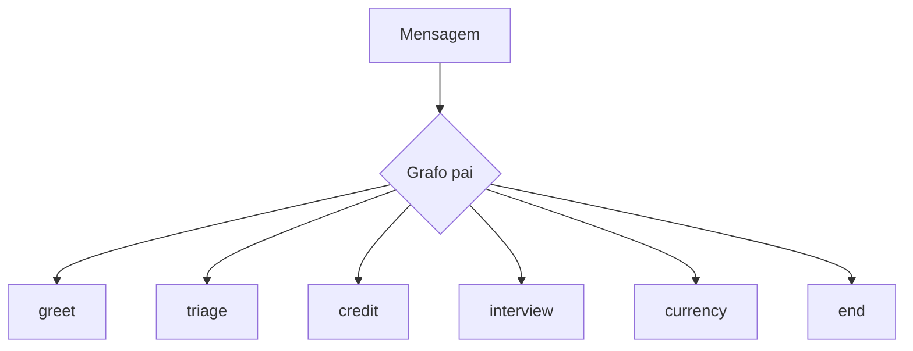

# Banco Ágil

## Sumário

- [Funcionalidades](#funcionalidades)
- [Arquitetura](#arquitetura)
- [Fluxos](#fluxos)
- [Decisões](#decisoes)
  - [Qual pattern de multi-agent cabe neste atendimento?](#decisao-pattern)
  - [O modelo conduz a conversa, ou o código conduz e o modelo só extrai campos?](#decisao-modelo)
  - [Quem escreve a mensagem de limite, status e cotação?](#decisao-mensagem)
  - [O handoff leva o state inteiro ou só a mensagem nova?](#decisao-state)
  - [Quem decide que a conversa acabou?](#decisao-fim)
  - [O judge pode reprovar um case antes de concordar com um golden dataset?](#decisao-judge)
- [Evaluation](#evaluation)
- [Homologação](#homologacao)
- [Desafios](#desafios)
  - [A suíte e o judge mediam coisas diferentes](#desafio-suite)
  - [O crédito encerrou a conversa no handoff da entrevista](#desafio-entrevista)
- [Limitações](#limitacoes)
- [Execução](#execucao)
- [Estrutura](#estrutura)

Atendimento de um banco digital fictício. O cliente fala com um assistente no Streamlit. Por baixo, quatro agents em LangGraph dividem o trabalho: triagem, crédito, entrevista e câmbio. A troca entre eles é um handoff. O chat não mostra essa troca.

A triagem autentica CPF e data de nascimento em `clientes.csv`. Só depois o assunto segue para o agent que pode resolvê-lo. Limite, score, pedido e cotação vêm de tools. O modelo conduz a conversa e escolhe a tool. A regra fica no código.

A conversa fica na sessão do navegador. Clientes, faixas de limite e pedidos ficam em CSV. A cotação vem da AwesomeAPI. O modelo padrão é `gpt-4o-mini`.

Há dois níveis de teste. O pytest cobre a regra com o modelo fora do caminho. Uma suíte com o modelo real cobre os 34 cases. Arquivo, score e cotação são checados por código. A qualidade da fala é checada por um LLM-as-a-judge, e esse judge só vota depois de concordar com um golden dataset rotulado à mão.

<a id="funcionalidades"></a>

## Funcionalidades

- Saudação fixa, antes de qualquer chamada ao modelo
- Autenticação por CPF e data de nascimento, com no máximo três tentativas
- Sem autenticação, limite, score e cotação não são consultados
- Consulta de limite e pedido de aumento, com status `aprovado` ou `rejeitado`
- Aprovação atualiza `limite_credito` do cliente. A consulta seguinte mostra o valor novo
- Pedido menor ou igual ao limite atual não gera linha no CSV. O cliente é avisado a informar um valor maior
- Rejeição oferece a entrevista. Se o cliente recusa, o atendimento segue para cotação ou encerramento
- Entrevista com cinco perguntas: renda, emprego, despesas, dependentes e dívidas
- Score novo, de 0 a 1000, gravado em `clientes.csv`, e reanálise do pedido no crédito
- Cotação pela AwesomeAPI, com o valor em reais e uma frase de fechamento
- Encerramento pela tool `end_conversation` quando o cliente pede para terminar
- Falha de CSV ou de API gera uma explicação ao cliente e uma linha em `logs/errors.jsonl`. A tela continua no ar

<a id="arquitetura"></a>

## Arquitetura

A mensagem entra por um grafo pai. Ele não chama modelo. Só escolhe o nó.

```text
mensagem
  ├─ atendimento já encerrado        → end
  ├─ três falhas e não autenticado   → end
  ├─ ainda não houve fala do cliente → greet
  ├─ não autenticado                 → triage
  └─ autenticado                     → active_agent
```

`greet` e `end` escrevem texto fixo. `triage`, `credit`, `interview` e `currency` são subgraphs. Cada um repete o loop `model` → `tools` → `model`, com no máximo uma tool por passo.



O state é um só, `ConversationState`, compartilhado pelos quatro subgraphs. Os campos que atravessam o handoff são `messages`, `active_agent`, `authenticated`, `customer`, `interview`, `open_limit_request` e `handoff_reason`.

| Agent | Tools |
|---|---|
| Triagem | `authenticate_customer`, `refuse_other_customer_data`, `handoff_to_credit`, `handoff_to_currency`, `end_conversation` |
| Crédito | `get_credit_limit`, `request_limit_increase`, `handoff_to_interview`, `handoff_to_currency`, `end_conversation` |
| Entrevista | `record_interview_answer`, `submit_interview`, `handoff_to_credit`, `end_conversation` |
| Câmbio | `get_currency_quote`, `handoff_to_credit`, `end_conversation` |

Crédito e câmbio não escolhem a tool por `bind_tools`. O modelo devolve uma action, `CreditAction` ou `CurrencyAction`. O runtime transforma a action em uma tool call. Triagem e entrevista usam tool calling direto.

Handoffs permitidos:

| De | Para |
|---|---|
| triagem | crédito, câmbio |
| crédito | entrevista, câmbio |
| entrevista | crédito |
| câmbio | crédito |

A UI mostra só falas do cliente e do assistente. A mensagem da tool de handoff vai vazia. O Streamlit guarda a thread num `MemorySaver` dentro do `session_state`. Os CSV ficam em disco.

Camadas, de fora para dentro:

- `interfaces`: Streamlit
- `agents`: grafo, prompts, tools
- `application`: casos de uso chamados pelas tools
- `domain`: CPF, score, faixa de limite, cotação. Não importa CSV nem LangGraph
- `integrations`: CSV, AwesomeAPI, OpenAI, log de erro

<a id="fluxos"></a>

## Fluxos

Autenticação e encaminhamento:

```text
cliente
  → greet pede CPF e data
  → triage chama authenticate_customer
  → se o assunto já veio na frase, o handoff sai na mesma chamada
  → credit ou currency responde
```

Aumento recusado, entrevista e volta ao crédito:

```text
credit registra o pedido como rejeitado e oferece a entrevista
  → cliente aceita
  → interview faz uma pergunta por turno
  → a quinta resposta válida grava o score e faz handoff para credit
  → o nó prelude reanalisa o pedido e publica o status
  → o modelo de crédito não entra nesse turno
```

<a id="decisoes"></a>

## Decisões

<a id="decisao-pattern"></a>

### Qual pattern de multi-agent cabe neste atendimento?

**Pergunta.** Triagem, crédito, entrevista e câmbio precisam de escopos separados, e o cliente precisa ver um assistente só. Como organizar isso?

**Problema.** A entrevista dura vários turnos. O limite só existe depois da autenticação. O score só existe depois da entrevista. A troca de agent não pode aparecer no chat.

**Alternativas.** Um agent único enxerga todas as tools o tempo todo e pode consultar limite antes de autenticar. Subagents como tools do pai não seguram uma entrevista que para e espera a próxima frase. Um supervisor na frente de cada mensagem acrescenta uma chamada e tende a escrever "vou te transferir". Agents em paralelo não servem, porque os passos dependem uns dos outros.

**Solução.** Handoff rígido. `active_agent` guarda quem atende. A próxima mensagem entra nesse subgraph, sem outro modelo na frente. O handoff só aceita os destinos da tabela acima. A tool de handoff grava texto vazio, e o chat não mostra a passagem.

<a id="decisao-modelo"></a>

### O modelo conduz a conversa, ou o código conduz e o modelo só extrai campos?

**Pergunta.** Quem escolhe a tool, e quem aplica autenticação, faixa de limite e score?

**Problema.** O desafio pede agents que chamam tools. Também pede que CSV, cálculo e API não sejam substituídos por um número inventado.

**Alternativas.** Um nó determinístico, em que o modelo só preenche um schema e o Python responde com texto fixo, cumpre a regra e tira do modelo a escolha da tool. ReAct livre, com a lista completa de tools, deixa autenticação e handoff só no prompt. O modelo pode pular a autenticação ou misturar os escopos.

**Solução.** Cada agent tem uma lista fechada de tools. O modelo escolhe a tool e conduz a fala. A tool aplica a regra: grava tentativa, decide `aprovado` ou `rejeitado`, valida as cinco respostas e só então faz o handoff.

<a id="decisao-mensagem"></a>

### Quem escreve a mensagem de limite, status e cotação?

**Pergunta.** A tool já calculou o limite, o status ou a cotação. Quem escreve a frase que o cliente lê no chat?

**Problema.** Se o modelo redige essa frase, ele pode trocar o número, arredondar, ou não falar o resultado. O cliente então lê um valor diferente do que a tool retornou, ou não lê o resultado.

**Alternativas.** Deixar o modelo escrever e, depois, comparar a frase com o valor da tool. A comparação é frágil: "oito mil", "R$ 8.000,00" e "8000" são o mesmo valor, e uma frase com dois números não diz qual conferir. A outra alternativa é confiar na redação do modelo, que é o problema acima.

**Solução.** A tool monta a frase e guarda em `required_notice`. Em crédito e câmbio, o modelo não escreve limite, status nem cotação. Ele escolhe uma action, como `consult_limit`, `request_increase` ou `quote`. O runtime chama a tool e coloca a frase da tool no chat. Se o modelo escrever outra coisa, ou não escrever nada, a frase que aparece é a da tool.

Quando o status é `aprovado`, o código atualiza `limite_credito` antes de gravar o pedido. O PDF não pede essa escrita. Sem ela, a frase diz que o aumento foi aprovado e a consulta seguinte ainda mostra o limite antigo.

<a id="decisao-state"></a>

### O handoff leva o state inteiro ou só a mensagem nova?

**Pergunta.** O que precisa chegar ao próximo agent junto com a troca?

**Problema.** No primeiro desenho, a tool devolvia só `active_agent` e a mensagem da tool. O `Command` para o pai substituía o state por esse update. O `customer` gravado na autenticação, no mesmo turno, se perdia. O crédito abria sem saber quem era o cliente.

**Alternativas.** Devolver só a mensagem nova repete essa perda. Um histórico separado por agent, com um resumo no handoff, faz o próximo agent perguntar de novo o que o cliente já disse.

**Solução.** Ao ver `Command.PARENT`, o runtime junta o state do subgraph com o update da tool. A tool continua devolvendo só o que ela mesma mudou. Os quatro subgraphs leem o mesmo `ConversationState`, inclusive a frase original do cliente.

<a id="decisao-fim"></a>

### Quem decide que a conversa acabou?

**Pergunta.** O que encerra o atendimento quando o cliente pede para sair?

**Problema.** O PDF manda chamar a tool de encerramento. Uma busca por "fim", "sair" ou "encerrar" também dispara em "estou a fim de aumentar meu limite".

**Alternativas.** Substring no router gera esse falso positivo e não chama `end_conversation`. Uma lista fechada de despedidas deixa "Pode finalizar pra mim?" de fora e tira a decisão do agent.

**Solução.** O agent ativo chama `end_conversation`. O nó `end` escreve a despedida. O código encerra sozinho só em dois casos que não dependem de interpretar a frase: a terceira falha de autenticação, e uma mensagem que chega depois do atendimento já ter terminado.

<a id="decisao-judge"></a>

### O judge pode reprovar um case antes de concordar com um golden dataset?

**Pergunta.** Quando um case falha, a falha é do agent, do teste ou do judge?

**Problema.** Uma conversa boa na UI não responde isso. O modelo muda de uma run para outra. O judge também erra. Um case ainda pode falhar porque o teste cobra uma regra que o PDF não escreveu. O pytest com modelo scriptado prova a regra, e não prova que o modelo real escolhe a tool certa.

**Alternativas.** Julgar só pela tela não se repete quando o prompt muda. Tratar o pytest como prova do modelo mede o teste, não o agent. Calibrar o gabarito no que o código já faz esconde divergência com o PDF. Pedir várias métricas na mesma chamada faz um veredito puxar o outro, e o judge deixa de ser o que a calibração mediu.

**Solução.** O judge é calibrado em `eval/calibration/goldens.jsonl`. Cada chamada julga um critério e responde `passa` ou `falha`. O critério só entra no gate com pelo menos 90% de acordo com os rótulos. `python3 -m eval.calibration.run` grava o relatório. `python3 -m eval` apenas lê esse arquivo. Sem o relatório, nenhuma métrica do judge reprova o agent.

<a id="evaluation"></a>

## Evaluation

Testar um agent é mais do que ler a última frase. A tool certa pode ter sido chamada e a fala ainda ser ruim. A fala pode parecer boa e o CSV estar errado. O judge pode reprovar uma fala que o PDF aceita.

Por isso a avaliação tem três peças.

| Peça | O que prova | Como roda |
|---|---|---|
| pytest | Regra, CSV, handoff, reanálise e avisos, com modelo scriptado | `docker compose run --rm app pytest` |
| Suíte do agent | 34 cases com o modelo real. Código confere state, CSV, score e cotação | `python3 -m eval` |
| Golden dataset | Se o judge concorda com rótulos humanos antes de votar | `python3 -m eval.calibration.run` |

Os requisitos do desafio estão em `eval/datasets/requirements.json`. `eval/datasets/coverage.json` marca todos como cobertos.

O ponto central é o golden dataset. Transcrições foram rotuladas à mão, com `passa` ou `falha` por critério. O judge só ganha voto depois de concordar com esses rótulos. Abaixo de 90% num critério, ele continua medindo, mas não reprova o agent. Assim, uma falha de `tone` ou `relevance` não é tratada como falha do agent enquanto o judge não mostrou que sabe aplicar o critério.

O relatório que o runner lê é `eval/calibration/report.json`: 83 rótulos, concordância de 98,8%. Sete critérios votam. `scope` ficou em 8 de 9 e não vota.

`relevance` e `tone` entram em todo case. `relevance` é medida e não fecha o gate: ela não está em `decision_criteria_eligible`. Em `eval/reports/last_run.json`, o gate do agent passou. Não houve falha de código em case P0 ou P1. `AUTH-002` recebeu `falha` em `relevance`, e essa métrica não entra na decisão.

Na suíte, a cotação vem de uma fixture, não da AwesomeAPI. Cada case copia os CSV para um diretório temporário.

<a id="homologacao"></a>

## Homologação

Suba a aplicação, abra [http://localhost:8501](http://localhost:8501) e atualize a página antes de cada caso. A conversa mora na sessão do navegador. Os casos 3 e 5 gravam CSV. Para repetir, rode `python3 scripts/revert_data.py`.

O cliente vê um assistente só. Não deve aparecer "transferir", "encaminhar", "agente" nem "setor".

| CPF | Nascimento | Perfil |
|---|---|---|
| 529.982.247-25 | 12/05/1990 | Ana Souza, limite R$ 800,00 |
| 111.444.777-35 | 20/08/1985 | Bruno Lima, limite R$ 3.000,00 |
| 390.533.447-05 | 03/01/1992 | Carla Mendes, limite R$ 7.000,00 |
| 153.509.460-56 | 15/11/1988 | Diego Rocha, limite R$ 15.000,00 |
| 862.883.667-57 | 28/03/1995 | Elena Castro, limite R$ 40.000,00 |

**1. Autenticação e limite.** Abra a página e não digite nada. A saudação pede CPF e data. Envie `Quero ver meu limite`. O assistente pede os dados e não informa limite. Envie `Meu CPF é 529.982.247-25` e depois `Nasci em 12/05/1990`. O limite informado é R$ 800,00, sem frase de transferência.

**2. Formato inválido e três falhas.** `CPF 123, nasci ontem` explica o formato e a conversa continua. Três mensagens com o CPF `111.444.777-35` e datas erradas (`01/01/2000`, `02/02/2001`, `03/03/2002`) informam a falha nas duas primeiras e, na terceira, encerram com "Não foi possível autenticar após três tentativas." A entrada de mensagem some.

**3. Aumento aprovado.** `CPF 153.509.460-56, nasci em 15/11/1988, quero aumentar meu limite para 18000`. O pedido é aprovado e o limite passa a R$ 18.000,00. `Qual é o meu limite agora?` confirma R$ 18.000,00. Em `solicitacoes_aumento_limite.csv`, a linha do Diego tem `limite_atual` 15000, `novo_limite_solicitado` 18000 e `status_pedido` `aprovado`.

**4. Aumento rejeitado e cotação.** `CPF 111.444.777-35, nasci em 20/08/1985, quero aumentar meu limite para 8000`. O pedido de R$ 8.000,00 é rejeitado e a entrevista é oferecida. `Não quero a entrevista. Quero a cotação do dólar` mostra a cotação do USD em reais e fecha o assunto. O valor não é um número redondo inventado. O CSV ganha uma linha do Bruno com `status_pedido` `rejeitado`.

**5. Entrevista e reanálise.** Numa página nova, repita o pedido do Bruno para 8000 e aceite a entrevista. Responda, uma por mensagem: `Ganho R$ 10 mil`, `Sou formal`, `Gasto 2000 por mês`, `Nenhum dependente`, `Não tenho dívidas`. O score calculado é 649. A faixa permite até R$ 10.000,00, então 8000 é aprovado. A resposta diz o status e o novo limite, e não oferece a entrevista de novo. Em `clientes.csv`, Bruno fica com `score_credito` 649 e `limite_credito` 8000.

**6. Encerrar no meio.** `CPF 390.533.447-05, nasci em 03/01/1992, quero ver meu limite` informa R$ 7.000,00. `Pode encerrar o atendimento` responde "Atendimento encerrado. Obrigado por falar com o Banco Ágil." e a entrada some.

<a id="desafios"></a>

## Desafios

<a id="desafio-suite"></a>

### A suíte e o judge mediam coisas diferentes

**Problema.** Uma conversa que parece boa no Streamlit não diz se o multi-agent está certo. O modelo muda de run para run, o judge também erra, e um case pode falhar porque o teste cobra uma regra que o PDF não escreveu.

**Jornada.** Montei 34 cases representativos. A primeira leva achou falhas do agent: tool que já existia e não era chamada, confirmação pedida de novo quando o valor já estava na frase, e handoff anunciado ao cliente. Ajustei prompt e copy.

Outras falhas continuaram. Parte era o judge reprovando fala que o PDF aceita: encerrar na terceira tentativa, pedir a data em DD/MM/AAAA, dizer que o status é `rejeitado`, tratar cotação como assunto do banco. Essas transcrições entraram no golden dataset com o rótulo que o PDF exige.

Ajustei o prompt de cada critério, uma chamada por métrica, e rodei o golden dataset de novo. A concordância com os rótulos subiu. Também rodei a suíte do agent com `gpt-4o-mini` e `gpt-5-mini`. O modelo mais caro melhorou cotação e troca de assunto, e piorou entrevista e o aviso de rejeição. O agent ficou no `gpt-4o-mini`.

Com o judge alinhado aos rótulos, falha de case passou a indicar o agent, com menos falso positivo e falso negativo.

<a id="desafio-entrevista"></a>

### O crédito encerrou a conversa no handoff da entrevista

**Problema.** Na homologação, a entrevista fazia o submit, gravava o score e devolvia o turno ao crédito. O crédito lia a última mensagem do cliente, "Não tenho dívidas", chamava `end_conversation` e encerrava. O limite tinha sido atualizado. A tela só mostrava a despedida.

**Correção.** Com `handoff_reason=score_updated`, o nó `prelude` do crédito reanalisa o pedido e preenche `required_notice` com o status. O runtime publica essa frase e fecha o turno. O modelo não vê a última resposta da entrevista nesse turno.

**Resultado.** O cliente lê o status da reanálise. A entrevista não é oferecida de novo. O atendimento não termina no lugar da aprovação.

<a id="limitacoes"></a>

## Limitações

Neste take-home:

- A conversa vive no `MemorySaver` da sessão do navegador. Atualizar a página começa outro atendimento. O CSV permanece.
- A base é CSV, sem concorrência e sem autenticação de produção.
- Na entrega o tracing fica desligado. Ligado, o state do grafo pode aparecer no trace. O metadata não leva CPF.
- A suíte usa cotação de fixture, não a AwesomeAPI ao vivo.
- `scope` fica fora do gate do judge.
- `CREDIT-003` variou entre execuções repetidas com `gpt-4o-mini`. A suíte não sai idêntica em toda run.

Para um sistema real, eu trocaria a sessão do navegador por sessão persistente e identidade de verdade. Limite e pedido precisariam da mesma transação: hoje, se a gravação do pedido falha, o código desfaz o limite, mas os dois CSV não compartilham uma transação. `scope` precisaria de mais rótulos, e a suíte precisaria ser repetida, antes de o gate virar critério de release.

<a id="execucao"></a>

## Execução

Pré-requisito: Docker, e uma chave da OpenAI.

```bash
cp .env.example .env
```

Preencha `OPENAI_API_KEY` no `.env`. O modelo padrão é `gpt-4o-mini`.

```bash
docker compose up --build
```

Abra [http://localhost:8501](http://localhost:8501).

Pytest, na imagem construída:

```bash
docker compose run --rm app pytest
```

Para repetir a homologação depois dos casos que gravam CSV:

```bash
python3 scripts/revert_data.py
```

Evaluation, na máquina local, com as dependências de `requirements.txt` e `OPENAI_API_KEY` no `.env`. O `.env.example` aponta `DATA_DIR` para `/app/data` porque a UI roda no container. A evaluation não usa esse diretório: cada case copia os fixtures para uma pasta temporária.

```bash
python3 -m eval.calibration.run
python3 -m eval
```

O primeiro comando calibra o judge e grava `eval/calibration/report.json`. O segundo lê esse relatório e grava `eval/reports/last_run.json`. Os dois aceitam `--publish` quando `LANGSMITH_API_KEY` está definida.

Para o LangSmith na UI, no `.env`:

```bash
LANGSMITH_TRACING=true
LANGSMITH_API_KEY=...
LANGSMITH_PROJECT=banco-agil
```

Na entrega e na demonstração, deixe o tracing desligado.

<a id="estrutura"></a>

## Estrutura

```text
agile_bank/
  domain/          CPF, score, faixa, cotação
  application/     casos de uso
  integrations/    CSV, AwesomeAPI, OpenAI, log
  agents/          state, runtime, grafo pai, tools, um pacote por agent
  interfaces/      Streamlit
data/              CSV usados pela UI
seeds/             cópia inicial dos CSV
scripts/           revert_data.py
eval/              suíte, judge, golden dataset, relatórios
tests/             pytest com modelo scriptado
app.py
```
