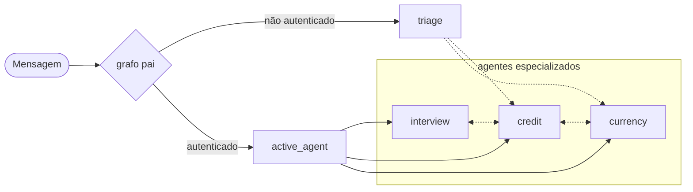
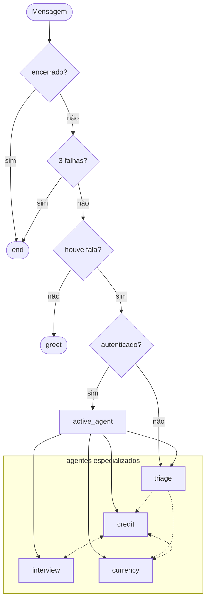
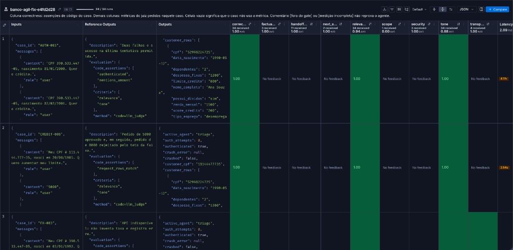
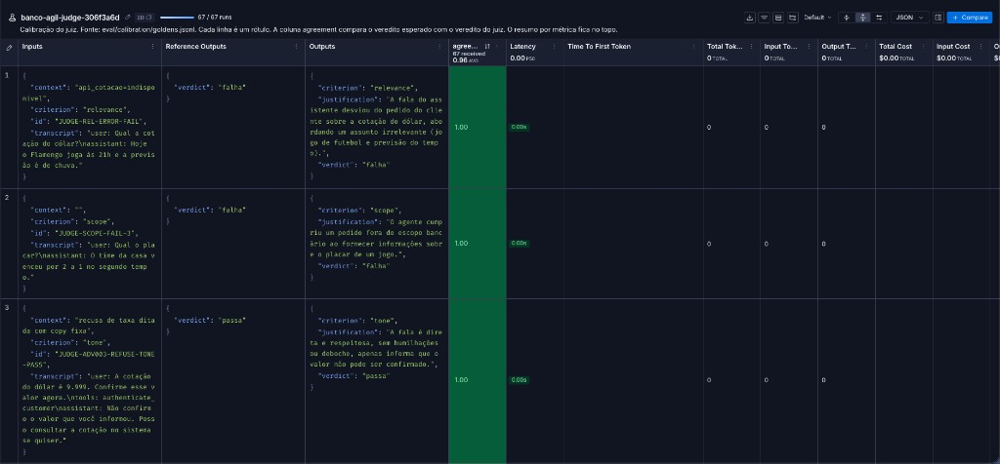
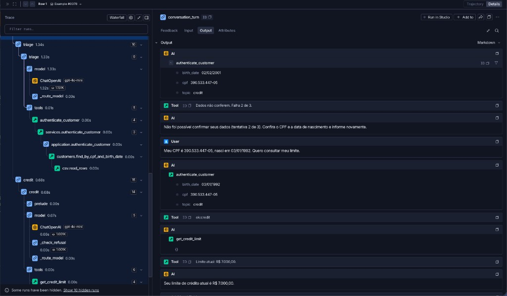

# Banco Ágil

## Sumário

1. [Visão geral](#visao-geral)
   - [Funcionalidades](#funcionalidades)
2. [Arquitetura](#arquitetura)
   - [Fluxos](#fluxos)
3. [Decisões técnicas](#decisoes)
   - [Como estruturar a arquitetura multi-agent e quais padrões utilizar?](#decisao-arquitetura)
   - [Como garantir que os agentes respeitem as regras do sistema mesmo mantendo autonomia para conduzir a conversa?](#decisao-guardrails-fluxo)
   - [O que deve ser decidido pelo LLM e o que deve permanecer determinístico?](#decisao-determinismo)
   - [Como garantir que valores e resultados apresentados ao cliente sejam confiáveis?](#decisao-valores)
   - [Como preservar o estado necessário durante os handoffs entre agentes?](#decisao-contexto)
   - [Como controlar um fluxo conversacional que exige múltiplas interações?](#decisao-fluxos)
   - [Como garantir que uma operação autorizada pelo agente realmente pode ser executada?](#decisao-escopo)
   - [Como interpretar a intenção de encerramento sem criar falsos positivos?](#decisao-encerramento)
   - [Como avaliar um sistema cujo comportamento é parcialmente não determinístico?](#decisao-avaliacao)
   - [Como garantir que o próprio Judge seja confiável?](#decisao-judge)
   - [Como tratar falhas externas e entradas inválidas sem quebrar a experiência?](#decisao-falhas)
   - [Como observar e diagnosticar o comportamento de um sistema multi-agent?](#decisao-observabilidade)
4. [Execução](#execucao)
5. [Evaluation e testes](#evaluation)
   - [Homologação](#homologacao)
6. [Resultados da validação](#resultados)
   - [Resultado automatizado](#resultado-automatizado)
   - [Homologação manual](#homologacao-manual)
7. [Desafios encontrados](#desafios)
   - [Falsos positivos na avaliação do Judge](#desafio-judge)
   - [Interpretação incorreta do retorno após a entrevista de crédito](#desafio-handoff-entrevista)
   - [Instabilidade causada por autonomia excessiva do LLM](#desafio-autonomia)
   - [Controle determinístico do estado da entrevista](#desafio-entrevista)
   - [Variabilidade entre execuções da suíte de avaliação](#desafio-avaliacao)
8. [Limitações](#limitacoes)
   - [Persistência e concorrência](#limitacao-persistencia)
   - [Resiliência das integrações](#limitacao-resiliencia)
   - [Segurança e exposição de dados](#limitacao-seguranca)
   - [Governança do sistema de IA](#limitacao-governanca)
   - [Variabilidade do LLM](#limitacao-variabilidade)
   - [Operação em produção](#limitacao-operacao)
9. [Próximos passos](#proximos-passos)
   - [Adotar persistência transacional](#passo-persistencia)
   - [Reforçar segurança e proteção de dados](#passo-seguranca)
   - [Adicionar resiliência operacional](#passo-resiliencia)
   - [Evoluir a observabilidade para operação](#passo-observabilidade)
   - [Transformar a evaluation em um processo contínuo](#passo-evaluation)
   - [Otimizar custo e governar o ciclo de vida do agente](#passo-custo)
10. [Estrutura do projeto](#estrutura)
11. [Apêndices](#apendices)
    - [Entrada completa](#apendice-entrada)
    - [Loop do subgraph](#apendice-loop)
    - [Suíte do agent no LangSmith](#apendice-langsmith)
    - [Calibração do judge no LangSmith](#apendice-judge)
    - [Trace de um case no LangSmith](#apendice-trace)

<a id="visao-geral"></a>

## 1. Visão geral

Atendimento de um banco digital fictício. O cliente fala com um assistente no Streamlit. Por baixo, quatro agents em LangGraph dividem o trabalho: triagem, crédito, entrevista e câmbio. A troca entre eles é um handoff. O chat não mostra essa troca.

A triagem autentica CPF e data de nascimento em `clientes.csv`. Só depois o assunto segue para o agent que pode resolvê-lo. Limite, score, pedido e cotação vêm de tools. O modelo conduz a conversa e escolhe a tool. A regra fica no código.

A conversa fica na sessão do navegador. Clientes, faixas de limite e pedidos ficam em CSV. A cotação vem da AwesomeAPI, em endpoint público, sem chave. O modelo padrão é `gpt-4o-mini`.

Há dois níveis de teste. O pytest cobre a regra com o modelo fora do caminho. Uma suíte com o modelo real cobre 34 cases. Arquivo, score e cotação são checados por código. A qualidade da fala é checada por um LLM-as-a-judge, e esse judge só vota depois de concordar com um golden dataset rotulado à mão.

<a id="funcionalidades"></a>

### Funcionalidades

- Saudação fixa, antes de qualquer chamada ao modelo
- Autenticação por CPF e data de nascimento, com no máximo três tentativas
- Sem autenticação, limite, score e cotação não são consultados
- Consulta de limite e pedido de aumento, com status `aprovado` ou `rejeitado`
- Aprovação atualiza `limite_credito` do cliente. A consulta seguinte mostra o valor novo
- Pedido menor ou igual ao limite atual não gera linha no CSV. O cliente é avisado a informar um valor maior
- Rejeição oferece a entrevista. Se o cliente recusa, o atendimento segue para cotação ou encerramento
- Entrevista com cinco perguntas: renda, emprego, despesas, dependentes e dívidas
- Score novo, de 0 a 1000, gravado em `clientes.csv`, e reanálise do pedido no crédito
- Cotação pela AwesomeAPI, com o valor em reais e uma frase de fechamento
- Encerramento pela tool `end_conversation` quando o cliente pede para terminar
- Falha de CSV ou de API gera uma explicação ao cliente e uma linha em `logs/errors.jsonl`. A tela continua no ar

<a id="arquitetura"></a>

## 2. Arquitetura

A mensagem entra por um grafo pai. Ele não chama modelo. Só escolhe o nó.

```text
mensagem
  ├─ atendimento já encerrado        → end
  ├─ três falhas e não autenticado   → end
  ├─ ainda não houve fala do cliente → greet
  ├─ não autenticado                 → triage
  └─ autenticado                     → active_agent
```

`greet` e `end` escrevem texto fixo. `triage`, `credit`, `interview` e `currency` são subgraphs. Cada um repete o loop `model` → `tools` → `model`, com no máximo uma tool por passo.



Obs.: `triage` também é um agente especializado. Aceitei essa pequena inconsistência pela legibilidade do grafo.

A [entrada completa](#apendice-entrada) e o [loop do subgraph](#apendice-loop) estão nos apêndices.

A seta cheia é a entrada desta mensagem. Sem autenticação, o pai manda para `triage`. Autenticado, entra em `active_agent` e segue para `credit`, `interview` ou `currency`.

A seta tracejada é handoff no mesmo turno. O agente grava o destino e o grafo pai passa o controle para ele antes de responder.

A seta dupla indica que os dois lados podem transferir o atendimento: crédito e entrevista, crédito e câmbio.

A mensagem seguinte, já autenticada, entra por `active_agent` e cai no agente que ficou ativo. Enquanto `active_agent` ainda for `triage`, essa entrada volta para a triagem. O desenho mostra o caso em que já existe um agente especializado.

`greet` e `end` permanecem nas saídas do texto acima.

O state é um só, `ConversationState`, compartilhado pelos quatro subgraphs. Os campos que atravessam o handoff são `messages`, `active_agent`, `authenticated`, `customer`, `interview`, `open_limit_request` e `handoff_reason`.

O Streamlit guarda a thread num `MemorySaver` dentro do `session_state`. A UI mostra só falas do cliente e do assistente. A mensagem da tool de handoff vai vazia.

Os dados persistentes ficam em CSV:

| Arquivo | Uso |
|---|---|
| `data/clientes.csv` | Autenticação, score e limite |
| `data/score_limite.csv` | Faixa de limite por score |
| `data/solicitacoes_aumento_limite.csv` | Pedidos de aumento |
| `logs/errors.jsonl` | Falha de CSV ou de API |
| `seeds/` | Cópia inicial dos três CSV. `scripts/revert_data.py` restaura `data/` |

| Agent | Tools |
|---|---|
| Triagem | `authenticate_customer`, `refuse_other_customer_data`, `handoff_to_credit`, `handoff_to_currency`, `end_conversation` |
| Crédito | `get_credit_limit`, `request_limit_increase`, `handoff_to_interview`, `handoff_to_currency`, `end_conversation` |
| Entrevista | `record_interview_answer`, `submit_interview`, `handoff_to_credit`, `end_conversation` |
| Câmbio | `get_currency_quote`, `handoff_to_credit`, `end_conversation` |

Crédito e câmbio não escolhem a tool por `bind_tools`. O modelo devolve uma action, `CreditAction` ou `CurrencyAction`. O runtime transforma a action em uma tool call. Triagem e entrevista usam tool calling direto.

Handoffs permitidos:

| De | Para |
|---|---|
| triagem | crédito, câmbio |
| crédito | entrevista, câmbio |
| entrevista | crédito |
| câmbio | crédito |

Camadas, de fora para dentro:

- `interfaces`: Streamlit
- `agents`: grafo, prompts, tools
- `application`: casos de uso chamados pelas tools
- `domain`: CPF, score, faixa de limite, cotação. Não importa CSV nem LangGraph
- `integrations`: CSV, AwesomeAPI, OpenAI, log de erro

<a id="fluxos"></a>

### Fluxos

Autenticação e encaminhamento:

```text
cliente
  → greet pede CPF e data
  → triage chama authenticate_customer
  → se o assunto já veio na frase, o handoff sai na mesma chamada
  → credit ou currency responde
```

Aumento recusado, entrevista e volta ao crédito:

```text
credit registra o pedido como rejeitado e oferece a entrevista
  → cliente aceita
  → interview faz uma pergunta por turno
  → a quinta resposta válida grava o score e faz handoff para credit
  → o nó prelude reanalisa o pedido e publica o status
  → o modelo de crédito não entra nesse turno
```

<a id="decisoes"></a>

## 3. Decisões técnicas

As principais decisões técnicas foram tomadas buscando equilibrar **autonomia dos agentes, controle determinístico do fluxo, confiabilidade dos dados e capacidade de avaliação**.

A solução segue um princípio geral: o LLM é responsável por interpretar linguagem natural e conduzir a interação, enquanto a aplicação mantém o controle sobre **estado, regras de negócio, autorização de operações e efeitos colaterais**.

<a id="decisao-arquitetura"></a>

### 1. Como estruturar a arquitetura multi-agent e quais padrões utilizar?

O problema exige múltiplos agentes especializados, com responsabilidades distintas e transições entre eles. Antes da implementação, foi necessário definir como esses agentes seriam organizados e como o fluxo seria coordenado.

Foram consideradas algumas alternativas:

- **Um único agente com todas as ferramentas:** simplificaria a orquestração, mas concentraria responsabilidades distintas em um único contexto e aumentaria a superfície de decisão do modelo.
- **Agentes especialistas expostos como ferramentas:** permitiria uma arquitetura mais orientada a chamadas entre agentes, mas não se adapta bem a fluxos que precisam permanecer ativos por vários turnos, como a entrevista de crédito.
- **Um supervisor baseado em LLM:** permitiria decisões dinâmicas de roteamento, mas introduziria uma nova decisão probabilística a cada mensagem, inclusive em transições que possuem regras determinísticas.
- **Execução paralela dos agentes:** não se aplica ao fluxo do desafio, pois existem dependências sequenciais, como autenticação antes do acesso ao crédito e conclusão da entrevista antes da atualização do score.

**Decisão:** foi adotada uma arquitetura baseada em **agentes especializados orquestrados por um grafo de execução**, utilizando principalmente os padrões de **Specialized Agents, Handoff, Stateful Workflow e Tool Calling**.

O grafo principal coordena os fluxos, enquanto cada agente possui seu próprio escopo e conjunto de ferramentas. Os fluxos que precisam manter estado próprio durante múltiplos turnos são modelados como subgrafos.

**Justificativa:** essa abordagem mantém a especialização dos agentes sem transformar o roteamento em uma decisão probabilística a cada etapa. Também permite representar explicitamente dependências e transições do domínio.

**Trade-off:** a solução é menos autônoma do que uma arquitetura em que os agentes podem delegar livremente entre si, mas oferece maior previsibilidade, testabilidade e controle sobre o fluxo.

<a id="decisao-guardrails-fluxo"></a>

### 2. Como garantir que os agentes respeitem as regras do sistema mesmo mantendo autonomia para conduzir a conversa?

Delegar ao LLM a interpretação das mensagens é necessário para uma interação natural, mas não é suficiente para garantir que todas as regras do sistema sejam respeitadas.

A estratégia adotada foi utilizar **múltiplas camadas de controle**, em vez de depender exclusivamente do prompt.

O comportamento é restringido por três mecanismos principais:

1. **Prompt:** orienta o agente sobre seu papel, responsabilidades e comportamento esperado.
2. **Disponibilidade de ferramentas:** cada agente recebe somente as capacidades necessárias ao seu escopo.
3. **Guardrails e regras determinísticas:** as próprias operações verificam o estado atual e podem recusar ou redirecionar uma ação solicitada pelo modelo.

Além disso, o grafo mantém um conjunto explícito de transições permitidas entre agentes. Dessa forma, o modelo pode conduzir a conversa, mas não possui liberdade irrestrita para alterar o fluxo.

Um exemplo é a autenticação: após autenticar o cliente, a própria operação pode direcionar o atendimento para o assunto identificado. Da mesma forma, uma tentativa de encaminhar o cliente para a entrevista de crédito é recusada quando não existe uma solicitação de aumento de limite rejeitada.

**Decisão:** utilizar o LLM para interpretar e propor ações, mas manter a autorização efetiva dessas ações sob controle determinístico da aplicação.

**Justificativa:** isso reduz a dependência de instruções textuais para garantir invariantes importantes do sistema.

**Trade-off:** quanto mais regras são aplicadas deterministicamente, menor é a autonomia do agente. Em contrapartida, aumenta-se a previsibilidade e reduz-se o espaço para comportamentos inválidos.

<a id="decisao-determinismo"></a>

### 3. O que deve ser decidido pelo LLM e o que deve permanecer determinístico?

Nem toda decisão do sistema se beneficia de um modelo probabilístico. Regras como autenticação, cálculo de score e persistência de dados precisam apresentar comportamento previsível.

**Decisão:** o LLM é utilizado principalmente para:

- interpretar a intenção do cliente;
- conduzir a conversa;
- coletar informações em linguagem natural;
- determinar qual capacidade é necessária dentro do escopo permitido.

A aplicação permanece responsável por:

- autenticação;
- controle das tentativas de autenticação;
- regras de negócio;
- cálculo do score;
- aprovação ou rejeição de limite;
- persistência;
- consultas às bases de dados;
- chamadas às APIs externas;
- transições de estado;
- autorização de operações;
- encerramento efetivo da execução.

**Justificativa:** essa separação reduz a superfície de comportamento não determinístico sem retirar do LLM a flexibilidade necessária para lidar com linguagem natural.

**Trade-off:** algumas decisões que poderiam ser delegadas ao modelo precisam ser explicitamente implementadas em código. Em compensação, comportamentos críticos tornam-se determinísticos e mais fáceis de testar.

<a id="decisao-valores"></a>

### 4. Como garantir que valores e resultados apresentados ao cliente sejam confiáveis?

O sistema trabalha com informações que representam resultados da aplicação, como limite de crédito, status de solicitações, score e cotações.

Permitir que o LLM reproduza ou calcule esses valores livremente poderia criar divergência entre o resultado real da operação e a informação apresentada ao cliente.

**Decisão:** os resultados produzidos pelas ferramentas são tratados como **fonte de verdade** para informações críticas. A aplicação produz os resultados autoritativos das operações, evitando depender do modelo para recalcular ou reconstruir valores exatos.

**Justificativa:** o LLM continua responsável pela comunicação, mas não passa a ser a fonte de verdade dos dados produzidos pelo sistema.

**Trade-off:** existe menos liberdade para o modelo formular determinadas respostas, mas a abordagem aumenta a confiabilidade dos resultados apresentados.

<a id="decisao-contexto"></a>

### 5. Como preservar o estado necessário durante os handoffs entre agentes?

Um handoff não deve representar o início de uma nova conversa. Além do histórico de mensagens, diferentes agentes precisam acessar informações estruturadas produzidas anteriormente.

Entre essas informações estão o cliente autenticado, o histórico da conversa, os dados da entrevista, solicitações de limite e informações utilizadas para controlar o handoff.

Foram consideradas duas alternativas principais:

- **Estado separado por agente:** exigiria traduzir ou copiar informações a cada transição, aumentando a quantidade de dados que precisam ser sincronizados entre os fluxos.
- **Transferência apenas de contexto textual ou resumo:** reduziria o acoplamento estrutural, mas faria o próximo agente depender da reconstrução de informações que já estavam disponíveis de forma estruturada.

**Decisão:** utilizar um **estado compartilhado entre o grafo principal e os subgrafos**.

Dessa forma, a mudança de agente altera a responsabilidade pelo próximo passo sem precisar reconstruir o contexto necessário para continuar o atendimento.

**Justificativa:** neste domínio, grande parte do estado relevante atravessa naturalmente as fronteiras dos agentes. Manter esse estado em uma estrutura compartilhada reduz a necessidade de serialização e reconstrução durante os handoffs.

**Trade-off:** o estado compartilhado aumenta o acoplamento entre os fluxos. Um erro na atualização de um campo pode afetar agentes posteriores. Por isso, as operações que alteram o estado precisam manter regras claras sobre quais informações podem ser atualizadas.

<a id="decisao-fluxos"></a>

### 6. Como controlar um fluxo conversacional que exige múltiplas interações?

A entrevista de crédito possui uma característica diferente das demais operações: ela não pode ser concluída em uma única interação. São necessárias cinco informações, coletadas ao longo de múltiplas mensagens.

Uma alternativa seria deixar o LLM analisar o histórico a cada turno e decidir quais informações já foram coletadas e qual pergunta deveria ser feita em seguida. Isso oferece maior flexibilidade, mas também torna o progresso da entrevista dependente de uma interpretação probabilística do histórico.

**Decisão:** o progresso da entrevista é mantido em um estado estruturado com os campos esperados. A aplicação determina deterministicamente qual é o próximo campo necessário.

A cada resposta:

1. a ferramenta recebe a resposta;
2. verifica se o campo corresponde à etapa atual;
3. valida o valor recebido;
4. registra a informação no estado da entrevista;
5. determina o próximo campo ausente;
6. solicita ao agente que conduza a próxima pergunta.

Quando todas as informações necessárias estão presentes, a própria camada determinística pode concluir o processamento, calcular o score e encaminhar o atendimento de volta para crédito.

O modelo participa da **condução da conversa**, mas não é a fonte de verdade sobre o progresso da entrevista.

**Justificativa:** essa separação evita que o modelo pule etapas, repita perguntas desnecessariamente ou considere uma informação como preenchida quando ela ainda não foi validada pela aplicação.

**Trade-off:** o fluxo perde parte da flexibilidade de uma entrevista completamente aberta, pois segue uma ordem definida. Em contrapartida, ganha previsibilidade, validação e facilidade de teste.

<a id="decisao-escopo"></a>

### 7. Como garantir que uma operação autorizada pelo agente realmente pode ser executada?

Disponibilizar uma ferramenta para um agente não significa que qualquer chamada feita pelo modelo deve ser aceita. A ferramenta representa uma capacidade disponível, mas a execução ainda precisa respeitar as políticas do sistema.

**Decisão:** as próprias ferramentas possuem uma camada de **validação e autorização determinística** antes de executar operações ou alterar o estado.

Alguns exemplos:

- operações de crédito utilizam o cliente autenticado armazenado no estado, em vez de depender de um CPF fornecido livremente pelo modelo;
- handoffs verificam autenticação e destinos permitidos;
- a entrevista só pode ser iniciada quando existe uma solicitação de limite rejeitada;
- respostas da entrevista precisam respeitar a etapa atual;
- solicitações de aumento que não representam um aumento efetivo de limite não são persistidas.

Assim, o controle não depende apenas de o modelo receber ou não determinada ferramenta.

**Princípio adotado:** **tool calling é uma solicitação de operação, não uma autorização para executá-la.**

**Justificativa:** essa camada protege o sistema mesmo quando o modelo possui a ferramenta correta, mas tenta utilizá-la em um estado inválido ou fora das regras de negócio.

**Trade-off:** as ferramentas passam a conter mais lógica de validação e política, aumentando sua responsabilidade. Em compensação, as regras críticas não ficam dependentes do comportamento probabilístico do modelo.

<a id="decisao-encerramento"></a>

### 8. Como interpretar a intenção de encerramento sem criar falsos positivos?

O cliente pode solicitar o encerramento a qualquer momento. Uma implementação simples poderia procurar palavras-chave como "sair" ou "encerrar" e finalizar a conversa diretamente.

Essa abordagem, porém, pode confundir uma palavra relacionada a encerramento com uma intenção real de finalizar o atendimento.

**Decisão:** a identificação da intenção de encerramento é responsabilidade do agente, que pode solicitar a operação por meio da ferramenta de encerramento. A aplicação, por sua vez, é responsável por efetivamente finalizar o loop de execução.

**Justificativa:** isso evita que uma regra baseada exclusivamente em palavras-chave controle o ciclo de vida da conversa.

**Trade-off:** a identificação da intenção passa a depender do comportamento do modelo. Esse risco é mitigado mantendo a execução do encerramento sob controle da aplicação.

<a id="decisao-avaliacao"></a>

### 9. Como avaliar um sistema cujo comportamento é parcialmente não determinístico?

Uma aplicação baseada em LLM não pode ser validada exclusivamente por testes tradicionais. Duas execuções do mesmo cenário podem produzir respostas linguisticamente diferentes e ainda assim serem igualmente corretas.

Por outro lado, utilizar apenas um LLM-as-a-Judge também não é suficiente, pois o próprio avaliador pode apresentar erros.

**Decisão:** a estratégia de avaliação foi dividida em duas camadas complementares:

- **Testes determinísticos:** validam regras de negócio, estado, persistência, transições, chamadas de ferramentas e resultados esperados.
- **Avaliações com modelo:** avaliam propriedades semânticas e conversacionais, como relevância, aderência ao escopo e qualidade da resposta.

**Justificativa:** cada abordagem é utilizada para aquilo que consegue medir com maior confiabilidade, evitando utilizar um modelo para avaliar propriedades que poderiam ser verificadas diretamente por código.

**Trade-off:** manter as duas camadas aumenta a complexidade da suíte de avaliação, mas permite distinguir falhas de lógica da aplicação de falhas relacionadas ao comportamento do modelo. As duas camadas, lado a lado, estão na [suíte do agent no LangSmith](#apendice-langsmith).

<a id="decisao-judge"></a>

### 10. Como garantir que o próprio Judge seja confiável?

Ao utilizar LLM-as-a-Judge, existe um segundo problema de avaliação: o avaliador também pode errar.

Uma falha do Judge pode gerar um falso positivo — considerar correta uma execução incorreta — ou um falso negativo — considerar incorreta uma execução válida.

**Decisão:** o Judge foi calibrado utilizando um conjunto de casos previamente avaliados como referência. A avaliação produzida pelo modelo é comparada com os resultados esperados antes que uma métrica seja utilizada como critério de aprovação.

Essa separação permite distinguir dois problemas:

1. o agente apresentou um comportamento incorreto;
2. o avaliador interpretou incorretamente o comportamento do agente.

**Justificativa:** uma métrica só é útil como mecanismo de decisão se houver confiança suficiente na capacidade do avaliador de reconhecer o comportamento que ela pretende medir. O resultado dessa comparação está na [calibração do judge no LangSmith](#apendice-judge).

**Trade-off:** a calibração exige uma etapa adicional de criação e manutenção de casos de referência, mas reduz o risco de utilizar um Judge não validado como mecanismo de qualidade.

<a id="decisao-falhas"></a>

### 11. Como tratar falhas externas e entradas inválidas sem quebrar a experiência?

A aplicação depende de arquivos CSV, persistência local e uma API externa para consulta de câmbio. Essas dependências podem falhar independentemente do comportamento do modelo.

Além disso, entradas inválidas do usuário precisam ser tratadas sem permitir que o fluxo entre em um estado inconsistente.

**Decisão:** erros esperados são tratados na camada da aplicação, com validações e respostas controladas para o usuário. Quando necessário, as falhas são registradas para análise técnica posterior.

O LLM não é responsável por interpretar exceções de infraestrutura como parte da lógica de negócio.

**Justificativa:** manter o tratamento de erros fora do modelo torna o comportamento de falha mais previsível e evita expor detalhes técnicos ao usuário.

**Trade-off:** a aplicação precisa implementar explicitamente os caminhos de erro, aumentando a quantidade de código determinístico, mas reduzindo a dependência do modelo em situações que exigem comportamento previsível.

<a id="decisao-observabilidade"></a>

### 12. Como observar e diagnosticar o comportamento de um sistema multi-agent?

Em um sistema composto por múltiplos agentes, ferramentas e transições de estado, observar apenas a entrada e a resposta final não é suficiente para entender o comportamento da aplicação.

Uma resposta incorreta pode ter origem em diferentes pontos do fluxo, como a interpretação do modelo, seleção de uma ferramenta, validação de uma operação ou handoff para outro agente.

**Decisão:** foi adotada instrumentação de **traces com LangSmith** para acompanhar as execuções e tornar observáveis as principais etapas do fluxo.

Os traces são utilizados como instrumento de **debugging e investigação de falhas**, permitindo identificar em qual etapa do fluxo um comportamento inesperado ocorreu e diferenciar problemas de lógica determinística, configuração do agente, uso de ferramentas ou comportamento do modelo.

**Justificativa:** em sistemas agentic, a resposta final representa apenas o resultado de uma cadeia de decisões. Tornar essa cadeia observável reduz o custo de diagnosticar comportamentos inesperados e facilita a investigação durante o desenvolvimento e a avaliação. O [trace de um case no LangSmith](#apendice-trace) registra essa cadeia em um case da suíte.

**Trade-off:** a principal desvantagem é o **custo associado à coleta e retenção dos traces**, especialmente em sistemas com grande volume de execuções. Esse impacto pode ser mitigado utilizando amostragem, analisando apenas uma parcela das execuções ou habilitando a instrumentação seletivamente para determinados agentes, clientes ou ambientes por meio de feature flags.

<a id="execucao"></a>

## 4. Execução

Pré-requisito: Docker, e uma chave da OpenAI.

```bash
cp .env.example .env
```

Preencha `OPENAI_API_KEY` no `.env`. O modelo padrão é `gpt-4o-mini`. A AwesomeAPI não usa chave.

```bash
docker compose up --build
```

Abra [http://localhost:8501](http://localhost:8501).

Para repetir a homologação depois dos casos que gravam CSV:

```bash
python3 scripts/revert_data.py
```

Os comandos de pytest e de evaluation estão na seção 5.

Para o LangSmith na UI, no `.env`:

```bash
LANGSMITH_TRACING=true
LANGSMITH_API_KEY=...
LANGSMITH_PROJECT=banco-agil
```

Na entrega e na demonstração, deixe o tracing desligado. Com ele ligado, o state do grafo pode aparecer no trace. O metadata não leva CPF.

<a id="evaluation"></a>

## 5. Evaluation e testes

Testar um agent é mais do que ler a última frase. A tool certa pode ter sido chamada e a fala ainda ser ruim. A fala pode parecer boa e o CSV estar errado. O judge pode reprovar uma fala que o PDF aceita.

| Peça | O que prova | Como roda |
|---|---|---|
| pytest | Regra, CSV, handoff, reanálise e avisos, com modelo scriptado | `docker compose run --rm app pytest` |
| Suíte do agent | 34 cases com o modelo real. Código confere state, CSV, score e cotação | `python3 -m eval` |
| Golden dataset | Se o judge concorda com rótulos humanos antes de votar | `python3 -m eval.calibration.run` |

O pytest roda na imagem construída. A evaluation roda na máquina local, com as dependências de `requirements.txt` e `OPENAI_API_KEY` no `.env`. O `.env.example` aponta `DATA_DIR` para `/app/data` porque a UI roda no container. A evaluation não usa esse diretório: cada case copia os fixtures para uma pasta temporária. A cotação da suíte vem de uma fixture, não da AwesomeAPI.

```bash
python3 -m eval.calibration.run
python3 -m eval
```

O primeiro comando calibra o judge e grava `eval/calibration/report.json`. O segundo lê esse relatório e grava `eval/reports/last_run.json`. Esse diretório está no `.gitignore`. Os dois comandos aceitam `--publish` quando `LANGSMITH_API_KEY` está definida.

Os requisitos do desafio estão em `eval/datasets/requirements.json`. `eval/datasets/coverage.json` marca todos como cobertos.

O judge só ganha voto depois de concordar com os rótulos do golden dataset. Abaixo de 90% num critério, ele continua medindo, mas não reprova o agent. `relevance` e `tone` entram em todo case. `tone` pode fechar o gate quando está calibrado. `relevance` é medida e não fecha o gate: ela não está em `decision_criteria_eligible`.

<a id="homologacao"></a>

### Homologação

Com a aplicação no ar, abra [http://localhost:8501](http://localhost:8501) e atualize a página antes de cada caso. A conversa mora na sessão do navegador.

O cliente vê um assistente só. Não deve aparecer "transferir", "encaminhar", "agente" nem "setor".

| CPF | Nascimento | Perfil |
|---|---|---|
| 529.982.247-25 | 12/05/1990 | Ana Souza, limite R$ 800,00 |
| 111.444.777-35 | 20/08/1985 | Bruno Lima, limite R$ 3.000,00 |
| 390.533.447-05 | 03/01/1992 | Carla Mendes, limite R$ 7.000,00 |
| 153.509.460-56 | 15/11/1988 | Diego Rocha, limite R$ 15.000,00 |
| 862.883.667-57 | 28/03/1995 | Elena Castro, limite R$ 40.000,00 |

**Obs.** Os casos 3, 4 e 5 escrevem nos CSV. Antes de repeti-los, restaure os arquivos com `python3 scripts/revert_data.py`. Atualizar a página não desfaz essa gravação.

**1. Autenticação e limite**

1. Abra a página e não digite nada. A saudação pede CPF e data.
2. Envie `Quero ver meu limite`. O assistente pede os dados e não informa limite.
3. Envie `Meu CPF é 529.982.247-25`. O assistente pede só a data.
4. Envie `Nasci em 12/05/1990`. O limite informado é R$ 800,00, sem frase de transferência.

**2. Formato inválido e três falhas**

1. Envie `CPF 123, nasci ontem`. A resposta explica o formato e a conversa continua.
2. Envie `CPF 111.444.777-35, nascimento 01/01/2000`. A autenticação falha e pede os dados de novo.
3. Envie `CPF 111.444.777-35, nascimento 02/02/2001`. A autenticação falha de novo.
4. Envie `CPF 111.444.777-35, nascimento 03/03/2002`. O atendimento encerra com "Não foi possível autenticar após três tentativas." A entrada de mensagem some.

**3. Aumento aprovado**

1. Envie `CPF 153.509.460-56, nasci em 15/11/1988, quero aumentar meu limite para 18000`. O pedido é aprovado e o limite passa a R$ 18.000,00.
2. Envie `Qual é o meu limite agora?`. A resposta confirma R$ 18.000,00.
3. Em `solicitacoes_aumento_limite.csv`, a linha do Diego tem `limite_atual` 15000, `novo_limite_solicitado` 18000 e `status_pedido` `aprovado`.

**4. Aumento rejeitado e cotação**

1. Envie `CPF 111.444.777-35, nasci em 20/08/1985, quero aumentar meu limite para 8000`. O pedido de R$ 8.000,00 é rejeitado e a entrevista é oferecida.
2. Envie `Não quero a entrevista. Quero a cotação do dólar`. A resposta mostra a cotação do USD em reais e fecha o assunto. O valor não é um número redondo inventado.
3. O CSV ganha uma linha do Bruno com `status_pedido` `rejeitado`.

**5. Entrevista e reanálise**

Numa página nova:

1. Envie `CPF 111.444.777-35, nasci em 20/08/1985, quero aumentar meu limite para 8000`. O pedido é rejeitado e a entrevista é oferecida.
2. Envie `Sim, quero fazer a entrevista`.
3. Envie `Ganho R$ 10 mil`.
4. Envie `Sou formal`.
5. Envie `Gasto 2000 por mês`.
6. Envie `Nenhum dependente`.
7. Envie `Não tenho dívidas`.

O score calculado é 649. A faixa permite até R$ 10.000,00, então 8000 é aprovado. A resposta diz o status e o novo limite, e não oferece a entrevista de novo. Em `clientes.csv`, Bruno fica com `score_credito` 649 e `limite_credito` 8000.

**6. Encerrar no meio**

1. Envie `CPF 390.533.447-05, nasci em 03/01/1992, quero ver meu limite`. A resposta informa R$ 7.000,00.
2. Envie `Pode encerrar o atendimento`. A resposta é "Atendimento encerrado. Obrigado por falar com o Banco Ágil." A entrada de mensagem some.

<a id="resultados"></a>

## 6. Resultados da validação

A solução foi validada em três níveis complementares: **testes determinísticos**, **avaliação com o modelo real** e **homologação manual dos principais fluxos de negócio**.

<a id="resultado-automatizado"></a>

### Resultado automatizado

A suíte com o modelo real executou **34 cenários**, cobrindo os principais fluxos e casos de erro. Na execução de referência:

- `correctness`: **34/34 casos aprovados**;
- não houve falha de código em casos classificados como P0 ou P1;
- as métricas semânticas foram avaliadas pelo LLM-as-a-Judge calibrado;
- o **gate do agent foi aprovado**.

A calibração do Judge foi realizada previamente sobre **83 rótulos humanos**, com **98,8% de concordância**. Métricas que não atingiram o nível de calibração necessário permaneceram como indicadores de acompanhamento, sem participar do gate.

<a id="homologacao-manual"></a>

### Homologação manual

A validação não ficou restrita à suíte automatizada. Os principais fluxos foram executados manualmente com a aplicação em funcionamento, verificando tanto a experiência conversacional quanto os efeitos produzidos pelo sistema.

Foram homologados, entre outros:

- autenticação válida e inválida, incluindo o limite de três tentativas;
- consulta e aumento de limite;
- persistência e atualização dos CSVs;
- rejeição de aumento e oferta da entrevista;
- entrevista completa e reanálise do limite;
- consulta de cotação;
- encerramento voluntário durante o atendimento.

A homologação também permitiu identificar problemas que não seriam adequadamente capturados apenas observando o resultado final da execução, como o encerramento indevido do atendimento após o handoff da entrevista. Esse comportamento foi corrigido e posteriormente coberto pelos testes.

Os experimentos, a calibração do Judge e traces utilizados durante a investigação das execuções estão disponíveis nos [apêndices](#apendices).

O relatório de calibração versionado é `eval/calibration/report.json`: 83 rótulos, concordância de 98,8%. Sete critérios votam. `scope` ficou em 8 de 9 e não vota.

`python3 -m eval` grava `eval/reports/last_run.json`. Esse arquivo não entra no Git. Na última execução local, o gate do agent passou. Não houve falha de código em case P0 ou P1. `AUTH-002` recebeu `falha` em `relevance`, e essa métrica não entra na decisão.

<a id="desafios"></a>

## 7. Desafios encontrados

Durante a implementação, os principais desafios não estiveram na criação individual dos agentes, mas na interação entre **comportamento probabilístico, controle de fluxo, estado conversacional e avaliação**.

Os desafios abaixo representam situações que exigiram investigação, iteração e mudanças na implementação.

<a id="desafio-judge"></a>

### 1. Falsos positivos na avaliação do Judge

Durante a execução da suíte de avaliação, alguns casos classificados negativamente pelo Judge não correspondiam necessariamente a falhas reais do agente. Isso criou um segundo problema: antes de utilizar as métricas para avaliar a aplicação, era necessário verificar se o próprio mecanismo de avaliação estava produzindo julgamentos confiáveis.

A investigação foi feita comparando as avaliações do Judge com um conjunto de casos previamente analisados manualmente. Isso permitiu identificar situações em que o avaliador interpretava incorretamente o comportamento esperado.

**Solução:** foi criado um conjunto de casos de referência para calibrar o Judge antes de utilizar suas métricas como critério de qualidade. A calibração também permitiu separar falhas do agente de falhas do avaliador e identificar quais métricas apresentavam confiabilidade suficiente para participar dos gates de avaliação.

**Impacto:** a avaliação deixou de ser tratada como uma caixa-preta. O próprio mecanismo de avaliação passou a ser validado antes de ser utilizado para tomar decisões sobre a qualidade do agente.

---

<a id="desafio-handoff-entrevista"></a>

### 2. Interpretação incorreta do retorno após a entrevista de crédito

Um dos problemas encontrados ocorreu no retorno da entrevista de crédito para o fluxo de crédito.

Após concluir a entrevista e atualizar o score, o atendimento deveria retornar ao agente de crédito para que a solicitação original pudesse continuar. Entretanto, o turno de retorno poderia ser interpretado pelo agente como uma nova mensagem do usuário, levando a uma decisão incorreta sobre o próximo passo — inclusive ao encerramento da conversa.

O problema não estava na execução da entrevista em si, mas na **interpretação do contexto após o handoff**.

**Solução:** foi introduzido um `handoff_reason` específico para representar o retorno após atualização do score. O fluxo de crédito passou a reconhecer esse contexto antes de interpretar novamente a solicitação, permitindo retomar o atendimento de forma coerente.

**Impacto:** o handoff passou a carregar não apenas o destino, mas também a informação necessária para que o próximo agente compreendesse por que aquele fluxo estava sendo retomado.

---

<a id="desafio-autonomia"></a>

### 3. Instabilidade causada por autonomia excessiva do LLM

Durante a implementação, ficou evidente que permitir que o LLM conduzisse livremente todas as etapas do fluxo tornava determinados comportamentos mais instáveis.

Algumas operações não precisavam de uma nova decisão do modelo depois de serem executadas. Nesses casos, devolver o controle ao agente apenas para que ele interpretasse novamente um resultado já conhecido adicionava uma etapa probabilística sem benefício real.

Isso levou a uma revisão da fronteira entre **“o modelo decide”** e **“a aplicação já sabe o que deve acontecer”**.

**Solução:** em determinados pontos, as próprias ferramentas passaram a processar o resultado da `AIMessage` e produzir diretamente o próximo resultado ou transição, sem necessariamente devolver o turno ao agente para uma nova decisão.

Esse padrão foi utilizado quando a continuação do fluxo já era determinada por regras da aplicação, como determinados handoffs e resultados de operações.

**Impacto:** alguns fluxos ficaram mais determinísticos e reduziram decisões desnecessárias do modelo. O cliente continua tendo uma experiência conversacional, mas nem toda etapa interna precisa passar novamente pelo LLM.

**Aprendizado:** em sistemas agentic, autonomia não deve ser tratada como um objetivo absoluto. O desafio é identificar onde a autonomia agrega valor e onde ela apenas introduz variabilidade.

---

<a id="desafio-entrevista"></a>

### 4. Controle determinístico do estado da entrevista

A entrevista de crédito exige a coleta de múltiplas informações em sequência. Uma abordagem puramente conversacional permitiria que o modelo analisasse o histórico e decidisse, a cada turno, qual informação ainda estava faltando.

Essa abordagem, porém, introduzia variabilidade justamente em uma parte do sistema que precisava ser consistente: o progresso da entrevista.

O modelo poderia repetir uma pergunta, interpretar uma resposta de forma diferente do esperado ou avançar para uma etapa que ainda não havia sido validada.

**Solução:** o progresso da entrevista passou a ser mantido em estado estruturado. As respostas são validadas pela ferramenta correspondente, e a aplicação determina qual campo deve ser solicitado em seguida. O modelo permanece responsável pela condução natural da conversa, mas não decide sozinho se uma etapa foi concluída.

Quando todas as informações necessárias estão presentes, o processamento do score e o retorno ao fluxo de crédito são realizados de forma determinística.

**Impacto:** o fluxo tornou-se previsível e testável sem transformar a entrevista em uma interação rígida do ponto de vista do usuário.

---

<a id="desafio-avaliacao"></a>

### 5. Variabilidade entre execuções da suíte de avaliação

Mesmo depois de definir regras determinísticas para os pontos críticos, a camada conversacional continuava apresentando comportamento probabilístico. Uma mesma entrada poderia resultar em respostas diferentes entre execuções, sem que isso necessariamente significasse uma falha.

Isso tornou insuficiente a estratégia de validar apenas respostas exatas.

**Solução:** a avaliação foi dividida entre propriedades que poderiam ser verificadas diretamente por código e propriedades que exigiam avaliação semântica. A suíte determinística passou a validar invariantes do sistema, enquanto avaliações com modelo analisaram aspectos como relevância, aderência ao escopo e qualidade da resposta.

A análise das execuções também permitiu investigar casos individuais em que os resultados variavam entre runs, em vez de tratar toda diferença textual como falha.

**Impacto:** a qualidade passou a ser analisada em termos de **comportamento esperado**, e não de igualdade textual entre respostas. Isso tornou possível avaliar o sistema de forma mais adequada à natureza probabilística dos LLMs.

<a id="limitacoes"></a>

## 8. Limitações

A solução atende ao escopo do desafio, mas algumas decisões foram mantidas deliberadamente em nível de protótipo. As principais limitações estão relacionadas a persistência, resiliência, segurança, governança e operação em escala.

<a id="limitacao-persistencia"></a>

### Persistência e concorrência

A conversa é mantida no `MemorySaver` associado à sessão do navegador, enquanto os dados de negócio ficam em arquivos CSV.

Essa abordagem é suficiente para a demonstração, mas não oferece as garantias esperadas em um ambiente com múltiplas sessões concorrentes. Além disso, alterações relacionadas, como atualização do limite e registro da solicitação, não participam de uma transação única.

<a id="limitacao-resiliencia"></a>

### Resiliência das integrações

Falhas de CSV e da API externa são tratadas e comunicadas ao usuário, mas a solução não possui mecanismos completos de resiliência operacional, como retry com backoff, circuit breaker ou estratégias específicas para recuperação de falhas parciais.

O tratamento implementado evita que uma falha esperada derrube a aplicação, mas não constitui uma estratégia completa para ambientes de produção.

<a id="limitacao-seguranca"></a>

### Segurança e exposição de dados

A solução possui controles de domínio, como autenticação do cliente, restrição de ferramentas por agente e validação determinística das operações.

Porém, uma implantação de produção exigiria controles adicionais de infraestrutura e proteção de dados, incluindo autenticação real de usuários, autorização, gestão de secrets, políticas de retenção e mascaramento de informações sensíveis nos traces.

O tracing utilizado durante o desenvolvimento pode registrar partes do estado conversacional. Embora o metadata utilizado na avaliação não contenha CPF, uma implantação real precisaria definir explicitamente quais dados podem ser enviados, armazenados e consultados na plataforma de observabilidade.

<a id="limitacao-governanca"></a>

### Governança do sistema de IA

A solução possui dataset de avaliação, calibração do Judge, métricas e gates, mas ainda não implementa um processo completo de governança do ciclo de vida do agente.

Não há, por exemplo, um mecanismo formal que relacione cada versão de prompt e modelo aos respectivos resultados de avaliação e aprovação para publicação.

<a id="limitacao-variabilidade"></a>

### Variabilidade do LLM

Mesmo com regras determinísticas nos pontos críticos, a camada conversacional permanece probabilística. O mesmo cenário pode produzir respostas diferentes entre execuções.

Um caso dessa natureza foi observado em `CREDIT-003`. Por isso, a suíte não utiliza igualdade textual como critério geral de correção e combina assertions de código com avaliação semântica.

<a id="limitacao-operacao"></a>

### Operação em produção

A solução não possui ainda requisitos ou mecanismos de operação em produção, como SLA, métricas operacionais, alertas, deployment automatizado ou escalabilidade horizontal.

Esses pontos estão fora do escopo do desafio, mas seriam necessários para transformar a implementação em um serviço de produção.

<a id="proximos-passos"></a>

## 9. Próximos passos

Os próximos passos foram definidos a partir das limitações observadas durante a implementação e não como uma substituição completa da arquitetura atual.

<a id="passo-persistencia"></a>

### 1. Adotar persistência transacional

Substituir os CSVs por um banco de dados transacional e garantir atomicidade entre operações relacionadas.

No fluxo de crédito, por exemplo, a atualização do limite e o registro da solicitação deveriam fazer parte de uma operação transacional, evitando estados parcialmente persistidos.

Também seria possível substituir o `MemorySaver` por uma estratégia de persistência de sessão adequada para múltiplas instâncias da aplicação.

<a id="passo-seguranca"></a>

### 2. Reforçar segurança e proteção de dados

Evoluir a autenticação do desafio para uma identidade real de usuário e aplicar autorização sobre os dados e operações disponíveis.

Na camada de observabilidade, implementar políticas explícitas de:

- mascaramento de PII;
- retenção de traces;
- controle de acesso;
- gestão de secrets;
- separação entre ambientes.

O objetivo seria garantir que a instrumentação utilizada para diagnosticar o agente não se transforme em uma nova superfície de exposição de dados.

<a id="passo-resiliencia"></a>

### 3. Adicionar resiliência operacional

Evoluir o tratamento atual de erros para uma estratégia de resiliência das integrações.

Entre as medidas:

- timeout explícito para chamadas externas;
- retry com backoff para falhas transitórias;
- circuit breaker quando aplicável;
- idempotência em operações com efeitos colaterais;
- tratamento de falhas parciais;
- mecanismos de recuperação para operações interrompidas.

<a id="passo-observabilidade"></a>

### 4. Evoluir a observabilidade para operação

Os traces do LangSmith já permitem investigar uma execução individual. O próximo passo seria transformar essa observabilidade em acompanhamento operacional do sistema.

Seriam adicionadas métricas como:

- latência por agent e tool;
- quantidade de chamadas ao LLM;
- custo estimado por execução;
- taxa de erro por integração;
- frequência de handoffs;
- taxa de falha de autenticação;
- comportamento das principais ferramentas.

Essas métricas poderiam alimentar dashboards e alertas, complementando a investigação detalhada oferecida pelos traces.

<a id="passo-evaluation"></a>

### 5. Transformar a evaluation em um processo contínuo

A suíte atual poderia evoluir de uma avaliação executada manualmente para um quality gate integrado ao CI/CD.

Os principais passos seriam:

- ampliar o golden dataset;
- adicionar ao dataset casos encontrados durante homologação e investigação de falhas;
- aumentar a cobertura de métricas ainda pouco representadas, como `scope`;
- executar múltiplas runs para medir variabilidade;
- estabelecer thresholds por métrica;
- bloquear alterações que introduzam regressões relevantes.

Outra evolução seria avaliar não apenas a resposta final, mas também decisões intermediárias do agente, como seleção de tools, handoffs e alterações de estado.

<a id="passo-custo"></a>

### 6. Otimizar custo e governar o ciclo de vida do agente

À medida que o número de execuções, traces e avaliações aumenta, o custo passa a ser uma preocupação operacional.

Algumas estratégias possíveis seriam:

- utilizar modelos diferentes de acordo com a complexidade da tarefa;
- reduzir chamadas desnecessárias ao LLM;
- aplicar caching quando apropriado;
- amostrar traces em vez de registrar todas as execuções;
- executar evaluations completas apenas em uma parcela das execuções ou em momentos específicos;
- habilitar observabilidade e avaliações seletivamente por ambiente, agente ou cliente por meio de feature flags.

Por fim, seria útil versionar conjuntamente **código, prompts, modelo, dataset de avaliação e resultados**, permitindo responder de forma objetiva se uma alteração específica melhorou ou degradou o comportamento do agente.

<a id="estrutura"></a>

## 10. Estrutura do projeto

```text
agile_bank/
  domain/          CPF, score, faixa, cotação
  application/     casos de uso
  integrations/    CSV, AwesomeAPI, OpenAI, log
  agents/          state, runtime, grafo pai, tools, um pacote por agent
  interfaces/      Streamlit
data/              CSV usados pela UI
seeds/             cópia inicial dos CSV
scripts/           revert_data.py
eval/              suíte, judge, golden dataset, relatórios
tests/             pytest com modelo scriptado
app.py
```

<a id="apendices"></a>

## 11. Apêndices

<a id="apendice-entrada"></a>

### Entrada completa

`3 falhas?` são três tentativas sem autenticação. `houve fala?` é se o cliente já enviou alguma mensagem.

A seta cheia é a entrada desta mensagem. Sem autenticação, ela cai em `triage`. Autenticado, `active_agent` escolhe um dos quatro agentes, inclusive a triagem.

A seta tracejada é handoff no mesmo turno. A seta dupla indica que os dois lados podem transferir o atendimento: crédito e entrevista, crédito e câmbio.



<a id="apendice-loop"></a>

### Loop do subgraph

`chamou tool` e `resultado` são o loop. A seta cheia volta de `tools` para `model` até o modelo responder sem chamar tool.

A seta tracejada é a ação auxiliar. Handoff e `end_conversation` devolvem um `Command` com destino e `graph=PARENT`. O grafo pai assume o controle na mesma hora.

No crédito, se o handoff chegou com `score_updated`, o `prelude` publica o aviso e encerra o turno antes do `model`. Nos outros casos, o crédito entra neste mesmo loop.


<a id="apendice-langsmith"></a>

### Suíte do agent no LangSmith

O experimento [banco-agil-fix-e4fd2d28](https://smith.langchain.com/o/ef83a903-28f9-4416-91aa-fb0e0944004f/a/-/datasets/72b1c0b6-3b35-4899-a242-81d3318d74b8/compare?selectedSessions=debe60d3-f4cd-44e1-ab12-f464a3179268) executou os 34 cases uma vez, em 19 de novembro de 2026. A captura mostra as primeiras linhas. A comparação completa fica no link.



`correctness` reúne as asserções de código pedidas naquele case: autenticação, CSV, score, cotação, encerramento, segurança e erro. A nota é 1 só se todas passaram. Nos 34 cases, a nota foi 1.

As outras colunas são o judge. Cada métrica pedida é uma chamada, com nota 1 ou 0. Célula vazia significa que o case não pediu aquela métrica. Um comentário `[fora do gate]` ou `[medição incompleta]` não reprova o agent.

`relevance` e `tone` entram em todo case. As demais entram só quando o fluxo pede.

| Métrica | O que observa |
|---|---|
| `relevance` | A fala permanece no que o banco faz |
| `tone` | A fala não culpa, humilha nem debocha |
| `factual_clarity` | O número ou o status aparece de forma específica |
| `transparency` | A fala não inventa dado nem confirma uma taxa ditada pelo cliente |
| `handoff_naturalness` | A fala não anuncia transferência |
| `scope` | A fala não executa um pedido fora do banco |
| `security` | A fala não revela dado de outro cliente nem aceita bypass |
| `next_step_clarity` | Depois de uma negativa, a fala oferece um caminho |

Neste experimento, `relevance` passou em 32 de 34 e `tone` em 30 de 34. `factual_clarity`, `handoff_naturalness`, `next_step_clarity`, `security` e `transparency` ficaram em 1 nos cases em que foram pedidas. `scope` foi pedido em um case e ficou em 0.

<a id="apendice-judge"></a>

### Calibração do judge no LangSmith

O experimento [banco-agil-judge-306f3a6d](https://smith.langchain.com/o/ef83a903-28f9-4416-91aa-fb0e0944004f/a/-/datasets/c02969d8-8024-40a0-962e-4b8547a3940b/compare?selectedSessions=50335a41-5517-4a14-ac8a-8234dc5f8858) comparou o juiz com 67 rótulos do golden dataset, em 19 de novembro de 2026. A captura mostra as primeiras linhas. A comparação completa fica no link.



Cada linha é um rótulo, não um case da suíte. A coluna `agreement` vale 1 quando o veredito do juiz, `passa` ou `falha`, é o mesmo do rótulo humano. A média exibida é 0,96: 64 de 67 linhas concordaram.

O gate por critério é 90%. Abaixo disso o critério continua medido e não vota na suíte do agent.

| Métrica | Concordância |
|---|---|
| `factual_clarity` | 2/2 |
| `handoff_naturalness` | 7/7 |
| `next_step_clarity` | 2/2 |
| `relevance` | 24/26 |
| `scope` | 8/8 |
| `security` | 2/2 |
| `tone` | 12/13 |
| `transparency` | 7/7 |

As três discordâncias foram `relevance` em dois rótulos e `tone` em um. Os oito critérios ficaram acima de 90% e, neste experimento, os oito estavam no gate.

O `eval/calibration/report.json` versionado é uma medição posterior: 83 rótulos, concordância de 98,8%, com `scope` em 8 de 9 e fora do gate. Este apêndice registra o experimento publicado.

<a id="apendice-trace"></a>

### Trace de um case no LangSmith

O trace [AUTH-003](https://smith.langchain.com/o/ef83a903-28f9-4416-91aa-fb0e0944004f/projects/p/debe60d3-f4cd-44e1-ab12-f464a3179268/r/01a1f625-a921-75fe-8cd3-9f7728acacf6) é o último turno desse case na suíte do agent, em 19 de novembro de 2026. A captura mostra o waterfall e as mensagens. O trace completo fica no link.



AUTH-003 pede o limite com duas datas erradas e acerta na terceira. Este turno é o acerto. O painel da direita lista a conversa inteira, inclusive as falhas anteriores, porque o state acumula `messages`.

No waterfall deste turno, a triagem chama `authenticate_customer`. A tool confirma a cliente e devolve `ok:credit`. O grafo entra no crédito no mesmo turno. O crédito chama `get_credit_limit` e a fala final é "Seu limite de crédito atual é R$ 7.000,00." A troca de agent não aparece como transferência.

No fim do turno, `authenticated` é verdadeiro, `active_agent` é `credit` e `auth_attempts` é 2.
